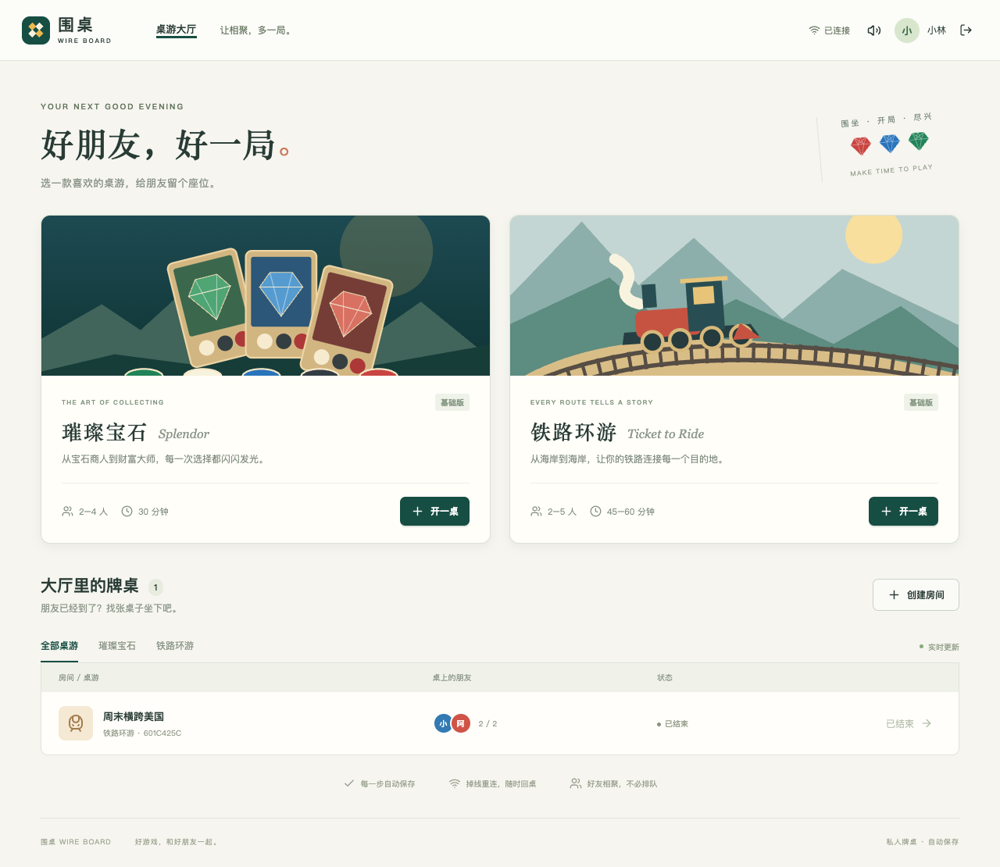

# 围桌 · Wire Board

为朋友小圈子搭建的中文游戏大厅：邀请码注册、登录、大厅、带密码的房间、准备与开局、实时联机、自动保存、断线重连、结算与再来一局。

- **璀璨宝石 Splendor 基础版**：2–4 人，90 张发展卡、10 位贵族；拿取、预留、黄金、折扣、弃置、贵族选择、完整最后一轮及同分判定。
- **铁路环游 Ticket to Ride 六张地图**：美国、欧洲、印度、瑞士、北欧、传奇亚洲，创建房间及准备阶段可选地图；支持对应人数、隧道、渡轮、车站、环游和网络奖励，以及电脑/托管、观战、私人任务进度。各地图的规则差异见 [地图说明](docs/rail-maps.md)。
- **卡坦岛 CATAN 基础版**：3–4 人，随机岛屿、蛇形起始建设、资源生产、强盗与同时弃牌、港口和玩家交易、五种发展卡、最长道路和最大骑士军队，自己的回合达到 10 分获胜。支持电脑玩家、观战与私人手牌。
- **卡卡颂 Carcassonne 基础版**：2–5 人，72 张地块、每人 7 名随从；地块旋转预览与确认、道路/城市/修道院/农民、区域占领与多数判定、完整终局计分。地图可拖动、滚轮缩放和适配全图，支持电脑玩家与观战，不含扩展。
- **三国杀**：4–8 人，经典身份局可选军争、风火林山、八位神将与界限突破标准将；独立基础国战包含60将、同势力双将及108张专用牌。完整身份／势力胜负、装备、技能、判定、无懈反制与濒死求桃。支持电脑、观战、响应倒计时及断线恢复，详见 [规则与实现](docs/sanguosha.md)。
- **兵线争锋 DotA 原创桌游**：1v1、2v2、3v3，开始后分队、交替选英雄、同时暗选行动；8 位经典英雄、17 件装备，所有模式均须摧毁敌方遗迹。支持电脑、托管、观战、队友计划可见与断线恢复，详见 [玩法与实现](docs/dota.md)。
- **强手棋 Monopoly**：2–6 人，买地、收租、拍卖、建房、抵押、交易与破产，最后未破产的玩家获胜，详见 [模块说明](games/monopoly/README.md)。
- **星垒 · 合作塔防**：1–4 人共同守城，10／20 波闯关和无尽模式、三档难度；四种塔、升级专精、分阶段扩大的多入口地图、地形投票、天气、团队成长、支线护送及分阶段首领。原创卡通素材、Canvas 动画、音效、暂停投票和断线恢复，详见 [玩法与验证](games/starfort/README.md)。新游戏默认下架，由管理员上架。
- **升级**：四人上海规则，一副牌四十分或两副牌八十分（默认两副），亮主、扣底、跟牌、拖拉机、甩牌和升级，支持打到过 A 与限定副数，详见 [模块说明](games/shengji/README.md)。
- **掼蛋**：四人江苏规则，对家搭档、红心级牌配牌、进贡还贡、接风和过 A，详见 [模块说明](games/guandan/README.md)。
- **斗地主**：新房间仅提供四人上海欢乐三打一，采用一档／二档／三档、头撩摊打、报到与炸弹次数限制；四王「王炸」压过八张炸弹，旧局继续按存档规则完成，详见 [模块说明](games/doudizhu/README.md)。三款扑克游戏默认下架，共用可更换的英式／插画／四色牌面与牌背，所有席位的本人手牌均在下方。
- **斯诺克**：纯 2D 俯视、标准十五红球，2 人单打与 4 人双打；力度、高低杆和侧旋、红彩交替、自由球、Miss 与原位重打、黑球决胜、队伍计分和多局赛。双打按整次上手轮换。默认下架，由管理员上架；详见 [玩法与验收](games/snooker/README.md)。
- **逐风赛车**：2D 俯视卡通漂移竞速，2～6 人真人与电脑混合比赛；林间、海岸和峡谷三条赛道，1／3／5 圈，车身外观不改变性能。支持 PC 键盘、手机多指方向盘／漂移／刹车、跟车镜头、观战、失联制动和托管。新增游戏默认下架，详见 [玩法与验证](games/racing/README.md)。
- **俄罗斯方块**：1 人单人练习，2～4 人实时对战；生存赛消行攻击、最后存活，40 行冲刺先完成者胜。支持电脑、托管、键盘与触屏、观战和断线恢复；单人练习保存成绩但不计积分。新增游戏默认下架，详见 [玩法与验证](games/tetris/README.md)。
- **街霸方块**：2 人实时落宝石对战；同色连通、碎裂宝石、强化宝石、钻石、反击宝石与连锁，8 名角色各有独立反击图案。默认三局两胜或单局决胜，支持电脑、托管、观战、键盘/触屏和断线恢复。新增游戏默认下架，详见 [玩法与验证](games/spf2t/README.md) 与 [验证记录](docs/spf2t-verification.md)。
- **平台积分与排行榜**：纯真人完整对局，第一名加分，其他名次扣分；阵营／队伍对局按团队结算。含电脑或中止不计分。战绩展示每局积分变化，详见 [积分规则](docs/ratings.md)。
- **支持电脑的游戏可单人体验**：房主在等待房间添加电脑玩家，自己准备后即可开局；可与朋友和多名电脑混合游玩，开局前可移除电脑。基础 AI 在服务端自动行动，无需外部模型、API 或额外配置。
- **临时托管**：支持电脑的游戏均可在对局中开启托管，昵称旁显示机器人图标；复用电脑策略，自动处理行动、选牌、弃牌与响应。关闭网页或服务重启后继续托管，回来可随时取消；座位、私人手牌和战绩积分仍属于原玩家，再开一局时自动恢复手动操作。倒计时结束后也会自动开启同样的持续托管。切换时保留尚未到期的倒计时；若当前响应已超时，取消托管会获得新的操作窗口。
- **闲置房间自动关闭**：等待中和进行中的牌桌连续 24 小时没有牌局操作会自动关闭，保留记录，不计胜负或积分。真人操作、电脑玩家及手动开启的托管行动会续期；刷新、观战、聊天、系统超时接管及其后续电脑行动不续期，服务重启后仍按原时间判断。
- **观战**：大厅可观看进行中的对局，不占玩家座位；密码房间需要密码。进行中隐藏手牌、预留卡和目的地等私人信息，可查看公开日志、在聊天中发言并标注「观战」，随时退出。
- **玩家与战绩**：点击真人昵称查看个人资料、各款游戏的战绩与分页历史；自己的页面可搜索玩家、申请好友、接受或移除好友。电脑不提供资料入口。大厅只显示全部等待中或进行中的房间，结束后移入个人历史；已结束对局不能新加入观战。
- **牌桌聊天**：右下角浮动聊天框，仅当前牌桌成员可见，带未读提示；最多保留最近 100 条，每条 500 字，刷新和服务重启后仍可查看。聊天不会重置回合或打断选牌。
- **管理后台**：永久管理员、普通管理员授权，游戏实时上下架、用户停用/恢复/强制退出/重置密码、在线与托管情况、活动牌桌管理及操作日志；权限和设置持久保存，详见 [管理说明](docs/admin.md)。
- **游戏许愿池**：玩家在大厅写下想实现的新游戏并可附参考图（PNG／JPEG／WebP／GIF，最大 5 MB）；图片上传到 OSS 不可变目录。管理员在后台审核，并把条目推进为已通过、正在实现、已实现或驳回；结果与备注回到玩家的「我的许愿」。配置只读令牌后，本地制作 agent 可以拉取这三种已审核状态，详见 [许愿池说明](docs/wishes.md)。
- **Go + React/TypeScript + SQLite + WebSocket**。前端嵌入 Go 程序，单实例，无 Redis、外部数据库；美术素材可通过自有 CDN 加载。游戏规则和隐藏信息由服务器管理。
- 原版资源配色、暖白与深绿大厅、标准底图上的可缩放中文铁路地图。声音通过平台统一媒体播放器输出，可静音；图片和音效支持 OSS。电脑、平板优先；地图支持滚轮以鼠标位置缩放、手型拖动和城市名开关，窄屏可触摸滑动；目的地任务可收起查看地图，完成进度仅本人可见。后台轮到自己时，标签页标题交替提醒。

## 界面预览



[璀璨宝石桌面](docs/screenshots/splendor.png) · [铁路环游桌面](docs/screenshots/rail.png) · [窄屏示例](docs/screenshots/rail-mobile.png) · [验证记录](docs/verification.md)

## Linux amd64 部署

GitHub Actions 自动产出 Linux amd64 压缩包、校验和与 `ghcr.io/k0ngk0ng/wire-board` 容器镜像。每次 main push 执行检查和构建；`v*` 标签复用同一提交的已验证构建，发布镜像和 GitHub Release，不重复运行完整检查。它不自动登录或修改你的服务器。

### 方式一：单个可执行文件

从 [Releases](https://github.com/k0ngk0ng/wire-board/releases) 下载 `wire-board-linux-amd64.tar.gz` 和 `SHA256SUMS`。仓库为私有时，需要登录有权限的 GitHub 账号；也可以在 Actions 对应运行页下载同名构建产物。

```sh
sha256sum -c SHA256SUMS
mkdir -p wire-board && tar -xzf wire-board-linux-amd64.tar.gz -C wire-board
cd wire-board
cp .env.example .env
# 编辑 .env，至少修改 INVITE_CODE
set -a
. ./.env
set +a
export ADDR=127.0.0.1:8080
export DATA_DIR="$PWD/data"
./wire-board
```

Go 二进制静态编译，不需要服务器安装 Go、Node 或 SQLite。首次运行自动创建数据库。内网直接访问可将 `ADDR=:8080`，并按网络需求开放端口。公网域名部署应配置 HTTPS，设置 `PUBLIC_ORIGIN=https://你的域名` 与 `COOKIE_SECURE=true`。`.env` 由 shell 或 Compose 加载，程序本身不读取 `.env` 文件。

建议用 systemd 管理长期进程，示例见 [部署说明](docs/deployment.md)。

### 方式二：Docker Compose

把 `compose.yaml`、`.env.example` 和 `scripts/update.sh` 放到服务器同一目录（Release 压缩包已包含这些文件）。公开镜像无需 GitHub 登录：

```sh
cp .env.example .env
# 编辑 .env，至少修改 INVITE_CODE；内网直连设置 BIND_ADDRESS=0.0.0.0
chmod 600 .env
chmod +x update.sh
sudo ./update.sh
docker compose logs -f
```

默认只监听 `127.0.0.1:8080`，适合接入服务器已有反向代理。SQLite 存在 `board-data` 命名卷；更新镜像不清空账号和对局。不要执行 `docker compose down -v`，这会删除数据卷。单局中断可以刷新或重新登录恢复；房主可以主动结束未完成牌桌。

以后在部署目录执行 `sudo ./update.sh` 更新，或 `sudo ./update.sh v1.1.1` 指定版本。脚本固定从 GHCR 拉取镜像，先下载、在线备份并校验压缩，最后才短暂切换容器；健康检查失败会尝试恢复旧镜像。Nginx、Certbot 和备份说明见 [部署说明](docs/deployment.md)。服务器地址、域名、邀请码和凭据仅保存在服务器配置中，不要提交到仓库。

运行 `sudo ./update.sh clean` 清理本项目旧镜像，保留当前部署、上一版回滚镜像及所有容器使用中的镜像；不清理其他服务、数据卷或备份。

## 环境变量

| 变量 | 默认值 | 含义 |
| --- | --- | --- |
| `INVITE_CODE` | 无，必须设置 | 注册邀请码；修改后已有账号不受影响 |
| `ADDR` | `:8080` | Go 监听地址，Compose 固定容器端口 8080 |
| `DATA_DIR` | `data` | 数据目录，容器中为 `/data` |
| `PUBLIC_ORIGIN` | 空 | 允许的源地址，例如 `https://board.example.com`，不带末尾斜杠 |
| `ASSETS_BASE_URL` | 空 | 可选 HTTPS 素材目录；配置与上传见 [素材部署](docs/assets.md) |
| `COOKIE_SECURE` | `false` | HTTPS 部署应设为 `true` |
| `BIND_ADDRESS` | `127.0.0.1` | 仅 Compose：宿主机绑定地址 |
| `PORT` | `8080` | 仅 Compose：宿主机端口 |
| `ADMIN_EXISTING_USERNAME` | 空 | 将明确指定的现有账号设为永久管理员，不改变密码、战绩或好友 |
| `ADMIN_USERNAME` / `ADMIN_PASSWORD` | 空 | 可选新建永久管理员，不能与上一项同时使用；密码 16–72 字节 |
| `OSS_ENDPOINT` / `OSS_BUCKET` / `OSS_ACCESS_KEY_ID` / `OSS_ACCESS_KEY_SECRET` | 空 | 同时配置后启用许愿参考图上传；留空仅支持文字许愿 |
| `WISH_IMAGE_BASE_URL` | `https://cdn.ichenj.com` | 许愿图片的公开 CDN 根地址 |
| `WISH_IMAGE_PREFIX` | `bga/wishes` | 许愿图片的 OSS 对象前缀 |
| `WISH_AGENT_TOKEN` | 空 | 本地制作 agent 的只读令牌，至少 16 字节；留空关闭代理接口 |

健康检查：`GET /healthz`。反向代理必须支持 `/api/ws` 的 WebSocket Upgrade，并保留原始 Host。示例见 [部署说明](docs/deployment.md)。

## 游戏模块开发

六款游戏的规则、前端与测试按 `games/<id>/` 拆分维护，继续共用一个仓库和部署服务。新游戏通过后端 `games/registry.go` 和自动发现的 `web/module.tsx` 接入，无需修改旧游戏的状态或动作类型。目录、兼容范围及验收命令见 [游戏开发说明](docs/game-development.md)。

## 本地开发与验证

需要 Go 1.26+、Node 22+。以下命令从仓库根目录执行，缓存和临时文件均存放在仓库 `.local` 中。

```sh
. scripts/env.sh
npm --prefix web ci
npm --prefix web run build

python3 -B scripts/ci/scope.py run --game shared
# 只验证当前开发的游戏；服务端规则改动时再增加 --backend。
python3 -B scripts/ci/scope.py run --game snooker
go vet ./...
go build -o .local/wire-board .
INVITE_CODE=local-friends ADDR=127.0.0.1:18080 DATA_DIR="$PWD/.local/data" .local/wire-board
```

前端开发：将后端监听 `127.0.0.1:8080`，运行 `npm --prefix web run dev`，通过 Vite 开发地址访问。第一次运行 Go 前需要先构建前端以满足 embed。

GitHub Actions 的 main 检查始终验证公共平台，并按最近已验证的祖先构建选择变更游戏；取消或失败的前序提交不会从检查范围中消失。游戏前端修改只运行对应前端／素材检查，服务端规则及夹具修改才运行该游戏的完整规则、对局和竞态检查。卡坦岛的大型规则套件按 20 片并行，其他游戏改动不会启动这些分片。工作流摘要及 `verification-plan` 产物列出本次范围，各检查保存独立结果；全部必需检查通过后生成二进制，版本 tag 只复用产物发布。

需要主动验收某款游戏时，在 main 工作流的手动入口填写游戏 ID；填写 `all` 才启动全游戏验收。本地全量 Go 验证仍可使用 `scripts/test_go_shard.py`；须运行全部分片，不能只用一片代表全量通过。

测试覆盖规则边界、资源守恒、完整 2/4 人璀璨宝石、六张铁路地图各最低/最高人数与 3/4 人卡坦岛对局、最长路线中的循环、隐藏信息、身份认证、CSRF、房间密码、并发和幂等、WebSocket 通知、重启恢复与结算后离桌。

## 设计与约定

- 房主开始前，所有真人必须准备；电脑自动准备。璀璨宝石与铁路至少两个座位、卡坦岛至少三个座位（含电脑），不必坐满。璀璨宝石随机决定起始玩家；兵线争锋随机决定先手队伍，并每轮轮换。
- 电脑玩家使用基础启发式策略，只依据公开牌面和自己的手牌、任务选择行动。每步间隔约 1–2 秒，行动照常持久化；刷新或服务重启后继续。电脑不会自动移出超时真人。房主移交给真人；最后一位真人离桌后清除电脑空房间。
- 兵线争锋每个分队/选人/规划阶段 120 秒，规划阶段共用倒计时；超时未操作的玩家自动托管，保留席位与队伍，可随时取消。
- 其他轮流行动游戏每回合 120 秒，倒计时持久化；超时后电脑自动接管，保留原玩家的座位、房主身份和战绩归属。三国杀普通响应沿用 20 秒。可以随时取消托管；不再通过超时移出玩家。房主可结束牌桌，此时不计胜负。
- 卡坦岛每组起始村庄与道路共用 120 秒，超时开启托管并分步放置；掷出 7 后所有待弃牌玩家共用 120 秒，超时只接管尚未弃牌的人，按电脑策略弃足数量，再给当前玩家新的 120 秒处理强盗。普通回合中的交易、建造、发展卡不重置时限。
- 铁路开局所有人同时选择目的地，120 秒后为未提交者开启托管并按电脑策略选牌；普通回合内的第二次摸牌、隧道追加和任务选择、璀璨宝石弃牌和贵族选择均不重置计时。
- 服务器按用户生成视图，不向对手发送秘密手牌、预留卡或目的地；结束后公开铁路任务。客户端只提交动作，不能指定结果。
- 每次操作在 SQLite 事务中保存局面和审计动作；版本号拒绝过期操作，唯一操作编号保证重试不重复执行。重启后仍有效。
- 璀璨宝石默认优先支付对应颜色宝石，也可主动选择黄金替代，保留其他宝石；可盲预留牌堆顶牌。
- 铁路环游的极端枯竭处理：不足三张普通列车牌可供形成市场时保留有限牌面，避免无限洗牌；所有玩家均无合法行动时提前结算。这两项是保证线上对局不死锁的明确约定。
- 暂不包含 AI 难度选择、铁路 1910/1912 任务扩展、排位匹配、邮箱找回或多人同时登录不同身份的同浏览器标签页。可使用不同浏览器配置文件测试多用户。
- 单实例设计，SQLite 数据目录应放在本地磁盘，不支持多个服务实例共享同一数据库文件。

素材和数据来源见 [第三方声明](docs/THIRD_PARTY.md)。项目不连接 BGA 游戏服务；璀璨宝石、铁路、卡坦岛与三国杀商业卡牌和地图由部署者配置；兵线争锋的经典小图标随程序保留本地后备副本，优先从已配置的素材 CDN 加载。

历史记录从本版本开始独立保存，不受离桌、删除房间或再来一局影响；升级时会收录服务器仍保留的已结束对局，先前已删除或被新一局覆盖的记录无法恢复。主动结束的牌桌仅在本人历史中显示，不计胜负。
