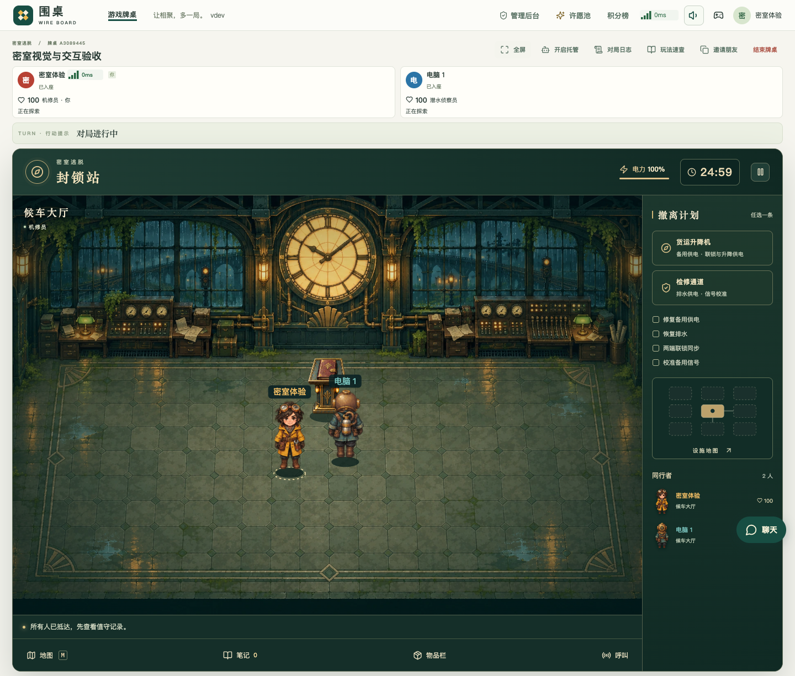
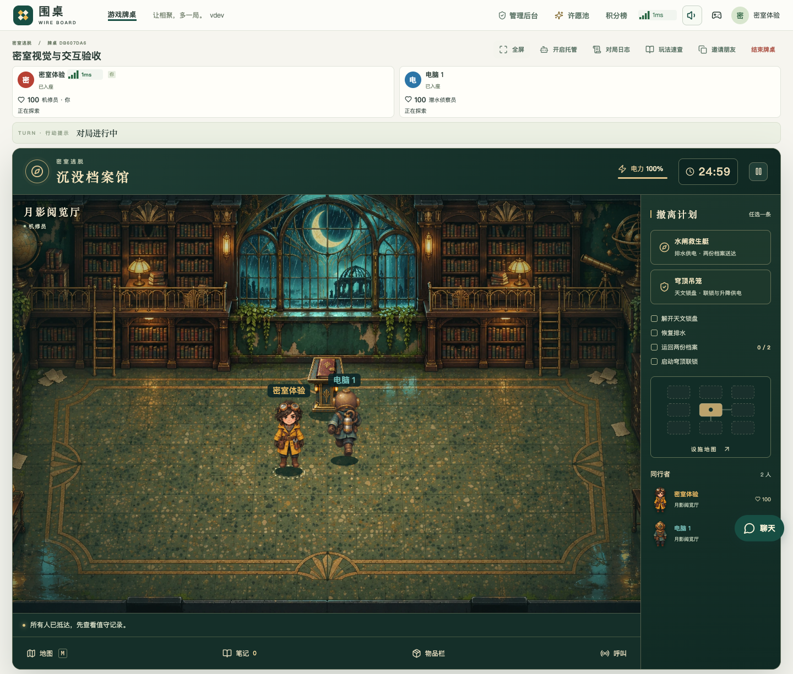
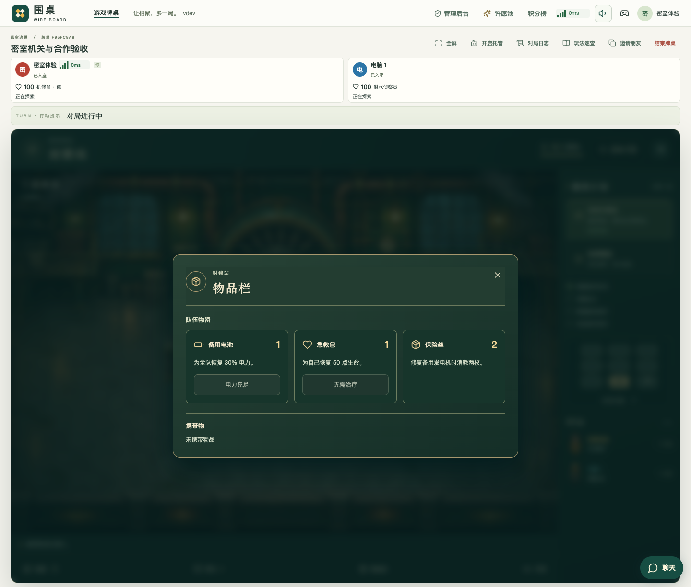

# 密室场景精简与物品栏验收

场景移除常驻的东南西北文字、独立门形图标、物件角标和未调查物件的地面标记。原有通行、调查与触屏命中区域保留；鼠标悬停和键盘焦点仍提供高亮，点击后显示调查反馈。

所有密室共用「物品栏」弹框。工具栏保留地图、笔记、物品栏、呼叫四个入口；弹框显示队伍物资的名称、数量、用途与可用操作，并单独显示个人携带物。封锁站显示电池、急救包、保险丝，沉没档案馆显示电池、急救包和已运回档案。物品使用仍由原有服务器操作校验。

## 验证结果

先补充失败场景和浏览器断言，再修改界面。旧版在「场景仍有方向文字和图标角标」断言上失败；最终版本通过以下验收。

| 范围 | 结果与证据 |
| --- | --- |
| 两种密室 × 桌面／320px 手机 | 4 组通过：无常驻按钮内容、命中区域至少 44px、悬停高亮、点击调查与通行、地图、全屏和刷新恢复。[浏览器结果](research/escape-scene-discovery/browser.json) |
| 物品栏 | 4 组均验证名称与权威库存一致、满生命时不可使用急救包、键盘焦点留在弹框、关闭入口可见、全屏层级正确；手机使用原生触摸打开。证据同上。 |
| 原有机关与新物品入口 | 封锁站桌面、档案馆手机共 2 组通过：读取线索、校准水阀、普通调查收集补给，在物品栏使用电池并验证电力恢复、库存扣减及界面同步，再完成配电与自然合作结算。手机电池通过原生触摸使用。[交互与结算结果](research/escape-scene-discovery/interaction.json) |
| 构建与对应前端检查 | `npm --prefix web run build`、`python3 -B scripts/ci/scope.py run --game escape` 通过。本次未修改规则与移动同步，不重复运行其他游戏验收。 |

以上手机结果来自桌面 Chromium 的 320px 视区和 CDP 原生触摸输入，不表示已在实体手机 Safari 上实测。测试入口、服务器启动方式见[游戏说明](../games/escape/README.md)。结果和截图的大小与 SHA-256 见[产物清单](research/escape-scene-discovery/artifacts.json)。

## 画面

[手机全屏物品栏](screenshots/escape-scene-discovery/archive-inventory-mobile.png)
