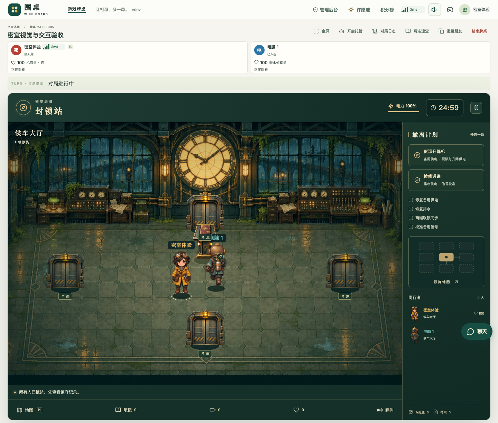
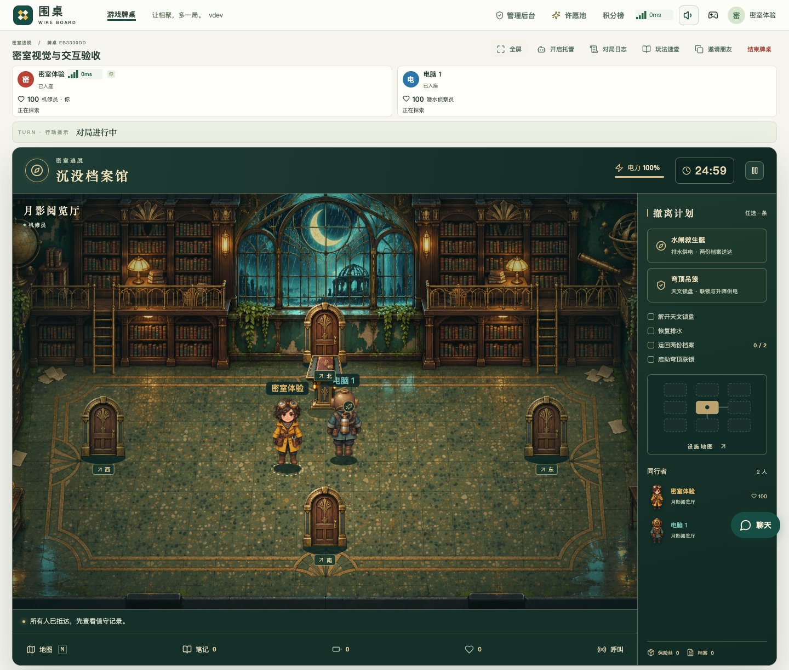
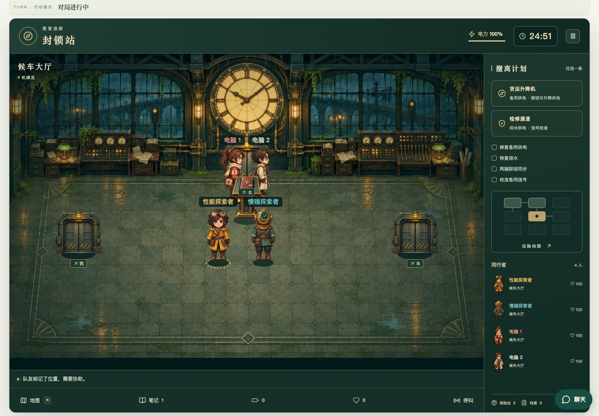

# 密室逃脱验收记录

场景精简与统一物品栏的后续结果见[场景探索与物品栏验收](escape-scene-discovery.md)。本文保留首版玩法、美术和实时同步记录。

本次交付在独立 worktree 中实现。游戏入口为「密室逃脱」，密室可选「封锁站」和「沉没档案馆」。以下结果来自正式注册模块、真实 HTTP／WebSocket／SQLite 和实际浏览器输入；测试服务器的网络故障入口不进入生产程序。

## 玩法与持久化

| 范围 | 结果 | 产物 |
| --- | --- | --- |
| 两种密室 × 2／3／4 人 × 三档难度 | 36 组主路线、18 组另一条路线，全部电脑通过普通动作共同撤离 | [54 组对局](research/escape-verification/campaigns.json) |
| 随机生成 | 2,000 个编号验证连通、前置房间、双人可完成条件与布局变化 | [生成记录](research/escape-verification/generation-corpus.json) |
| 合作机关 | 耦合阀门、共享配电容量、双端联锁、档案搬运、呼叫、临时改换路线与重复确认计划 | [动作链路记录](research/escape-verification/contracts.json)及[游戏检查范围](research/escape-verification/scope-escape.json) |
| 生存与恢复 | 预警、倒地、普通救援、全队失败、超时、暂停、手动接管与重启 | 同上，详细记录位于 `.local/escape/rules/` |
| 实际服务器完整对局 | 真人通过统一入口主动托管，与显式电脑自然通关两种密室；结算后重启保留同一结果、不计竞争积分 | 同上 |
| 平台接入 | 新游戏默认上架、权限、控制器默认配置保存、公共加载、观战、积分与平台状态契约 | [共享检查范围](research/escape-verification/scope-shared.json) |

未探索房间不返回物件和答案；随机地图种子与公开控制 epoch 独立。控制序号区分已接收与已应用；短按在服务器两帧之间仍产生真实位移，松开后不会重复推进。

## 浏览器与画面

桌面与 320px 手机分别验证两种密室，共 4 组基础场景。覆盖地图、笔记、真实鼠标探索、全屏边界、全屏生命与物资、关闭与重开、刷新恢复、键盘焦点。[浏览器结果](research/escape-verification/browser.json)

另一套真实界面测试从等待房间切换密室，读取队伍已发现的线索，点击旋钮解开耦合水阀，操作配电和容量限制，在手机上用原生触摸拖动检查面板，最后主动托管并到达自然合作结算。封锁站桌面和档案馆手机均通过。[交互与完整结算](research/escape-verification/interaction.json)

[手机全屏](screenshots/escape/archive-mobile-fullscreen.png) · [手机水阀机关](screenshots/escape/archive-pump-mobile.png) · [共享配电](screenshots/escape/station-circuits.png) · [手机合作结算](screenshots/escape/archive-victory-mobile.png)

## 实时与输入测量

浏览器通过实际 TCP 代理给单端增加 400 ms RTT。使用原生键盘／触摸事件，记录首次绘制及其后的实际呈现画面；可见帧率来自 Chromium screencast 的呈现时间与不同图像摘要，另保留绘制频率。ACK 单独记录。

| 条件 | 可见帧率 | 呈现间隔 P95 | 事件到首帧 P95 | 常规消息中位数 |
| --- | --- | --- | --- | --- |
| 正常键盘 | 约 59 FPS | 约 19 ms | 约 24 ms | 约 1.2 KB |
| 400 ms RTT 键盘 | 约 59 FPS | 约 19 ms | 约 28 ms | 约 1.2 KB |
| 400 ms RTT 手机触摸 | 约 60 FPS | 约 19 ms | 约 34 ms | 约 1.2 KB |
| 四人同室，快慢端并存 | 约 59 FPS | 约 19 ms | 慢端约 16 ms | 约 1.6 KB |

另验证单端真实连接中断、重新获得权威状态、清除旧按住输入和新输入恢复；健康端连接没有中断，规则持续推进。标准 Gamepad API 以虚拟设备验证模拟轴值、抖动合并和回中释放，未将其描述为实体手柄实测。[8 组性能与网络结果](research/escape-verification/performance.json)

以上是本次前台 Chromium 与当前机器的测量，不替代其他设备的性能测试。冻结指标、失败清单与复现命令见 [游戏说明](../games/escape/README.md) 和[先行验收](../games/escape/ACCEPTANCE.md)。

## 美术与资源

场景、设备、角色及行走帧由用户指定的 `gpt-image-2.5` 经 API 生成，所选原图和参考帧保存在游戏目录。运行素材统一裁切、调整比例并验证 SHA-256；四人靠近时仅在呈现层让出空间，保留真实交互位置。音频为原创合成，FLAC 与原 PCM 逐字节往返校验。

[美术规格](../games/escape/assets/art-direction.md) · [场景与精灵提示词](../games/escape/assets/prompts.jsonl) · [行走帧提示词](../games/escape/assets/walk-prompts.json) · [图像清单](../games/escape/assets/manifest.json) · [音频清单](../games/escape/assets/audio-manifest.json)

所有公开结果与截图的摘要保存在[验收产物清单](research/escape-verification/artifacts.json)。发布仍须通过同一提交的 CI、正式构建、本地 CDN 回读与生产更新检查。
