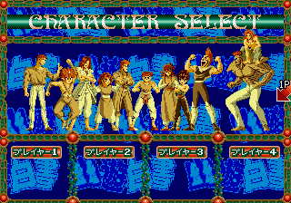
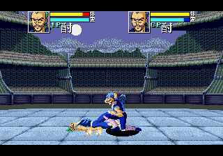

# MD《幽游白书：魔强统一战》复刻可行性与实施方案

本文保留首轮研究记录。2026-10-26 后续已在独立 worktree 启动规则恢复，并定位、修正研究工具的存档时序遗漏；最新状态见 [复刻进度](../../../games/yuyuhakusho/PROGRESS.md)。下文的 10 帧 RAM 差异是首轮原始工具结果，不代表附加时钟恢复后的新工具结果。

截至 2026-11-05，酎／默认场地已有[独立浏览器研究页](LOCAL_PLAYER.md)，全新对局、动态背景、HUD、存档恢复及原生／Wasm 轨迹一致性已验收。公共 MD 六键控制器已增加、SFC 配置已移除；其他角色动作、场地、声音和平台联机仍在继续。下文保留首轮时的方案与覆盖边界。

随后补齐户愚吕兄，浏览器现可在两个已恢复人物之间选择，完整动作／世界／新建对局与呈现结果见[双角色验收](../../../games/yuyuhakusho/verification/fighter10-session.json)。

当前进一步开放幻海，包含完整蓄力／散射父子对象与[三角色验收](../../../games/yuyuhakusho/verification/genkai-session.json)。来源 ID 与姓名已按[原 HUD 字形](CHARACTER_IDS.md)绑定，来源 0 为幻海、来源 3 为幽助。

现已进一步开放幽助，四个人物共用完整驱动，原世界／新建对局／原生输入证据见[四角色验收](../../../games/yuyuhakusho/verification/yusuke-session.json)。

研究日期：2026-10-26。用户已确认目标为 Treasure 开发的 MD《幽游白书：魔强统一战》，不是 FC、SFC 或 3DO 同名作品。本轮交付研究方案、工具探针和原版运行证据，未接入新游戏、改动平台实现或发布资源。

**结论：技术上可行，建议沿用「原版逐帧取证 → 独立 Go 规则 → 同源 Wasm 预测 → 原版对照验收」的路线。当前可以进入工具和规则取证阶段，尚不能承诺完整原版手感或发布工期。** 平台已有可参考的实时联机实现；主要难点是 68000 分析通路、战斗状态与招式判定还原、四人低延迟同步，以及 MD 三／六键输入。

## 本轮实际完成的验证

| 问题 | 结果 | 证据与边界 |
| --- | --- | --- |
| 是否找到并运行了目标作品 | 是。日版样本启动、选模式、选角色并进入酎对电脑酎的战斗 | 本机 Genesis Plus GX 原生 arm64 内核；不是网页录像，也不是自制演示 |
| ROM 身份是否固定 | 3,145,728 bytes；`GM G-004122-00`；区域 `J`；头部和计算校验和均为 `0x34ae` | [身份记录](rom-identity.json)；社区归档来源，尚未与独立的权威 dump 数据库交叉校验 |
| 固定输入能否重复执行 | 两个独立进程各从冷启动运行 3,600 帧，逐帧 RAM、视频及尺寸摘要全部相同 | [冷启动比较](coldboot-comparison.json)、[逐帧摘要](frame-hashes.json) |
| 存档能否作为严格对照基准 | 还不能完全确认。从第 2,400 帧恢复后重放 1,200 帧，视频全部一致，完整 RAM 有 10 帧不同 | [运行报告](runtime-report.json) 保留 `pass: false`；未屏蔽差异来凑通过结果 |
| REA 能否直接分析 MD ROM | 当前版本不能。6.5.0 裸二进制架构仅允许 x86、x86_64、ARM、ARM64、6502，没有 68000 或 Z80 | [当前服务及接口记录](rea-capabilities.json)；不能把 ROM 标成其他架构强行导入 |
| 底层 Ghidra 能否处理其代码 | 可以导入，并在复位附近的限定范围解析 131 条指令 | Ghidra 12.1.4，直接 headless 通路；[输出](ghidra-entry.txt)，并非通过 REA 恢复游戏逻辑 |
| 平台是否有可复用基础 | 有。游戏模块契约、加载屏障、托管、控制器配置、全屏和平台音效均已有实现；篮球还有 Go/Wasm 预测与重放 | 本轮基于当前工作区源码，包含未提交改动，不能视为线上已经具备全部能力 |
| 四人完整局、原版 AI、招式帧数据是否已验证 | 尚未验证 | 本轮原版运行只覆盖一个单人对电脑样本，不能外推为全角色／全模式验收 |

原版画面取证：

| 模式菜单 | 角色选择 | 实际战斗 |
| --- | --- | --- |
|  |  |  |

运行内核为 `Genesis Plus GX v1.7.4 60bee4c`，报告视频帧率 `59.92274340431231`，画面为 `320 × 224`，系统 RAM 为 64 KiB，存档大小为 1,036,288 bytes。**这个帧率是模拟器视频时基，不等于已经测出游戏每个规则子系统的更新频率。** 动作推进、停顿和原机掉帧仍需单独记录。

存档差异的已保存采样集中在内核原生 RAM 偏移 `0xfe52` 等靠近末尾的区域，可能涉及栈和中断时序，但本轮没有确认其因果，也没有把这些字节认定为可忽略数据。当前优先用已验证的冷启动输入回放建立基准；修复或解释恢复差异后，再批量生成中途存档夹具。

## 必须还原的玩法范围

公开资料记载本作有 11 名可用角色：浦饭幽助、桑原和真、藏马、飞影、幻海、户愚吕弟、户愚吕兄、酎、阵、仙水忍、树。前后双线场地、最多四人同时战斗，以及混战和两人一队是本作的主要特征。[资料来源](https://en.wikipedia.org/wiki/Yu_Yu_Hakusho_Maky%C5%8D_T%C5%8Ditsusen) 属于二手资料；下列细节需要原版逐帧核实。

| 子系统 | 还原重点 | 不能先做的假设 |
| --- | --- | --- |
| 移动与朝向 | 行走、前后冲刺、跳跃、落地、主动转向、前后线切换 | 不能照搬「后方向自动防御」；本作反向输入可用于转身 |
| 普通攻击 | 轻／重攻击、站立／蹲下／空中分支、投技、连击、受身及取消关系 | 同一动作的前摇、有效帧、收招、硬直和命中停顿必须取证 |
| 特殊招式 | 输入历史、搓招容错、蓄力、储存／释放、灵力消耗与恢复 | 不能仅凭攻略文字猜窗口，也不能在 UI 中自创一键必杀 |
| 双线判定 | 切线途中状态、跨线攻击、同线碰撞、投射物与遮挡 | 不能把双线只做成两条不同高度的绘图轨道 |
| 多人战斗 | 多目标命中、被夹击时的方向、防御、队伍伤害、击退和镜头 | 不能把双人碰撞循环重复三次就当作四人规则 |
| 结算与模式 | 胜拔战、练习、淘汰赛、混战与组队的实际关系；同归于尽和队伍胜负 | 公开资料称比赛没有时间限制；不能擅自添加比赛倒计时 |
| 电脑 | 目标选择、难度、反应延迟、距离／轨道判断、连段与特殊阶段 | 不能用追人加随机攻击策略宣称原版 AI 已还原 |
| 表现 | 动画帧、拼图、调色板、层级、闪烁、镜头和命中音效 | 解码出图块不等于恢复完整动画或获得发布许可 |

三键手柄可承担轻攻击、重攻击和防御，其他移动动作使用组合输入；六键可以提供额外动作映射。具体默认键位及可配置规则仍以原版选项和输入观察为准。本轮脚本使用的是 libretro 按钮编号，其到 MD 物理键的映射见后文，不能直接当作平台最终键位。

## 工具路线与 REA 缺口

推荐保留本次已验证的 Genesis Plus GX 内核作为自动回放工具。通过 libretro 可以按帧推进、提交输入、读取工作 RAM、保存状态和获取原生画面；上游代码也提供三键、六键与 Team Player 控制器类型。本轮未验证四个控制器同时参加完整对局，不能把接口存在当作这项验收通过。

BlastEm 可作为第二模拟器和调试器候选；本轮仅查阅项目资料，没有下载运行。需要先验证本机版本的断点、写入观察、单步及 VDP 读取能力，才能确定其调试职责。若为 Genesis Plus GX 增加研究钩子，应把它留在研究工具中，正式游戏不携带模拟器内核。

REA 本轮已完成当前能力核查及下载内核的包清单分析，证据保存在 [REA bundle](rea-evidence.json)。原始清单证据为 `ev_2ab17b73f98d0777bf03bfb99ab60b397c1fd01224473bc2755c78d8f3278228`；它绑定的是模拟器下载包，**不是原版玩法或 ROM 反编译证据**。

当前 REA 的缺口至少包括：

1. 在裸二进制架构、分析描述和工具 schema 中增加 68000 及大端语义；仅修改界面的枚举还不够。
2. 分开 ROM 载入地址与执行入口。本 ROM 映射起点为 `0x000000`，复位向量指向 `0x000200`，文件开头是向量表。
3. 保留 ROM 文件偏移、CPU 地址与镜像映射。本 ROM 为 3 MiB，不能套用 NES 的 PRG 分页方案；MD 的 24 位总线与指令中的符号扩展地址需要正确关联。
4. 描述工作 RAM、控制器 I/O、VDP 和 Z80 总线的内存区域；代码与压缩图片／表数据分开识别。Z80 音频程序属于另一种 CPU，不能交给 68000 解码器。
5. 用已知 68000 指令、向量、调用、条件码和内存访问夹具先验证，再开放函数、引用与伪代码查询。REA 当前使用的 load/entry 共用参数也需一并处理。

本轮没有修改 REA 安装或其他仓库。暂时可用 Ghidra 直接分析并输出带摘要的证据；后续再把已验证的导入能力接入 REA。直接使用的语言 ID `68000:BE:32:default` 在本机定义中描述为 68040，属于更宽的指令集合，不能认为它会自动排除 MD MC68000 不支持的指令。指令可达性、24 位地址折叠和硬件副作用必须由运行证据校验。

## 平台实现方案

建议游戏模块为 `games/yuyuhakusho/`，规则、电脑、同步协议及素材映射由本游戏维护；下列目录是方案，尚未创建实现。

```text
engine/     帧驱动状态机、输入识别、碰撞、招式、电脑与确定性状态
server/     房间规则、准备选择、席位鉴权、权威推进、恢复和结算
syncwire/   输入序列、帧号、摘要、检查点及协议版本
web/        Canvas 呈现、Wasm 预测、平台控制器／音效／全屏适配
assets/     素材来源和构建清单；正式媒体使用 OSS 不可变目录
```

### 规则与网络

采用独立 Go 逻辑，同一份核心编译为服务器原生实现和浏览器 Wasm。坐标、速度、随机数、动作阶段、判定框、灵力、硬直、命中停顿、输入历史和电脑内部状态均纳入确定性状态；保存时不能只保存人物位置和血量。先测原版时基，再决定固定步长与墙钟换算，不直接写死「每秒 60 次」当作已知事实。

平台参考点：

- [模块契约](../../../internal/gameapi/module.go) 已有 `Configure / Prepare / Apply / OnTimer / SyncSnapshot / BotAction / Reclaim / Restore`，平台负责鉴权、去重和发布，游戏负责规则。
- [公共调度](../../../internal/server/server.go) 的实时唤醒为 50 ms；[WS 推送](../../../internal/server/realtime_stream.go) 的普通快照也按 50 ms 合并。因此不能要求每个画面帧等待一份全量服务器快照。
- [篮球服务器](../../../games/basketball/server/module.go) 每 100 ms 驱动一批 60 Hz 内核帧，并保留帧输入；[篮球前端](../../../games/basketball/web/network-scene.ts) 重放权威输入、检查摘要并预测本地未来帧。这是可参考的结构，不是本游戏已经验证的延迟参数。
- 篮球当前只注册 1～2 个平台席位，不能据此宣称四人联机已有验收。其 [输入掩码](../../../games/basketball/engine/input.go) 为 `uint8`，也不足以直接容纳 MD 六动作键、四方向和 Start／Mode。

第一步复用服务器权威输入序列＋客户端预测，建立双人对打样本。建议输入消息至少容纳 16 位逻辑键，并包含对局 epoch、单席位序号、目标帧及按下／松开边沿。服务器验证允许的帧范围和权限；各席位按共同逻辑帧处理，不能按请求抵达先后决定同帧命中。

格斗需要单独测量按键至动作、远端确认和修正幅度。网络验收应覆盖本机、稳定网络和延迟／抖动／丢包条件，并保留实际数据；不能用「60 FPS」代替输入延迟测量。若现有预测机制无法达到手感要求，再增加有界服务端回滚：输入历史、确认帧、迟到输入窗口、重算预算及结果提交边界必须一起设计。平台当前未核实存在可直接使用的通用服务端回滚框架。

音效、命中特效和生命变化必须共享事件帧及稳定事件 ID，避免预测回退后重复播音或先扣血后命中。最终结算在确认边界提交；观战、重连和托管切换均从版本匹配的检查点恢复。

### 控制器与界面

公共 [控制器型号](../../../internal/server/controllers.go) 目前只有 FC `classic-2` 与 SFC `classic-4`。建议增加 MD 三键／六键型号，以六键作为便捷入口，保留三键原始组合操作。键盘、触屏与将来的实体手柄统一输出逻辑键；不能把 MD 硬塞进 FC 的两键和 Select 语义。

MD 视觉组件由平台共用，设置和游玩复用。键位按用户、型号隔离保存，触屏支持多指同时按方向与动作键。游戏区在上、控制器在下，PC 和 320px 手机分别验证；控制器不能覆盖战场，也不能因全屏丢失触屏操作。失焦、隐藏、离开房间、配置切换和取消托管必须释放对应输入。

创建房间沿用平台两步弹窗，选择人数与可用规则模式；角色、队伍和场地放到准备阶段，由服务器验证并保存，开赛直接进入战斗。真人席位与原版角色槽位分开映射。开放哪些 1～4 真人组合，应由原版模式取证和电脑覆盖结果决定；不能在界面开放尚未实现的容量／模式。分类使用统一模块元数据中的动作类，若增加格斗类则同步全平台目录，不设置「模拟器」入口。

普通页面的公共玩家栏显示生命和灵力，战场内 HUD 在全屏时仍完整可用。使用平台 `GameFullscreen`、游戏内 overlay root、加载屏障、结算浮层及 `BoardProps.audio`。加载进度覆盖代码、当前场景素材和画面实际初始化，全部真人就绪才推进规则；电脑和观战者不阻塞，重连不重新暂停全员。原版界面的 1P／CP 标识仅作为研究截图记录；正式角色素材不添加通用席位数字角标。

### 电脑、积分与素材

电脑恢复与招式恢复同步进行：先定位原版 AI 入口和决策数据，记录其观察量、难度与随机数，再恢复可解释策略。电脑经过与真人相同的合法输入通路，不能直接写伤害或胜负。开放的全部人数、队伍和模式都要支持电脑及主动托管；即时游戏不因断线或空闲自动接管。

任何固定电脑角色也应声明含电脑对局，不计竞技积分。真人和局使用平台显式和局，所有参与者积分变化为 0，不把所有人记为赢家。原版同时 KO 和多人排名规则尚待取证。

素材恢复按 ROM 图块／压缩数据 → 运行时 VRAM／调色板 → 精灵拼接 → 动画／判定关联逐层建立证据。音频可从参考运行记录场景和事件映射，但最终播放必须走平台媒体通道。素材来源、生成方式与 SHA-256 随版本保存，媒体和 Wasm 使用 OSS 不可变地址。

社区 ROM 归档没有提供可确认的发布许可；模拟器上游也使用特定的非商业许可。它们本轮仅用于本地研究。公开上线前需确认原版人物、图片、音乐和名称的使用权，或采用明确获准的素材；能提取资源不代表可公开分发。独立规则代码不直接解决素材授权问题。

## 实施顺序与验收门槛

| 阶段 | 交付物 | 进入下一阶段的条件 |
| --- | --- | --- |
| 1. 研究工具 | ROM 身份、确定性冷启动基准、输入记录、断点／写入观察、REA 68000 接入方案 | 明确 RAM 恢复差异；可定位帧循环、输入读取和角色状态；不依赖肉眼猜地址 |
| 2. 原版规格 | 模式／角色／动作清单、状态地址表、招式参数、判定与动画表、AI 路径证据 | 每个字段可追溯到 ROM 偏移、CPU 地址、帧号和输入样本；未知项保留为空 |
| 3. 最小独立战斗 | 先用一对角色完成移动、轻重攻击、防御、跳跃、切线、伤害及 KO，带电脑 | 先保存原版夹具，再实现规则；相同输入逐帧对比，Go 与 Wasm 摘要一致 |
| 4. 完整内容 | 扩展全部 11 角色、特殊招式、模式和原版电脑；素材／音频映射 | 每个开放模式均可完成对局，含混合真人／电脑与托管切换；不能以少量角色代替完整交付 |
| 5. 平台联机 | MD 控制器、准备选择、四人同步、断线恢复、全屏与手机适配 | 真实键鼠／触摸、PC／320px、多人网络干扰、同帧命中及回滚事件去重均有结果 |
| 6. 发布准备 | 范围化验收、资源许可与摘要、OSS 核验、已验证构建 | 只运行本游戏及实际改动的共享消费者检查；按仓库 main 验证、tag 复用产物的流程发布 |

复杂功能以 E2E 和原版输入回放为主要机制，先定义夹具再写实现。必须隔离验证的 CPU／解码器部分，先列失败场景再写代码。每次验收保留输入轨迹、核心和 ROM 摘要、首个差异帧、关键状态差异、截图及复跑命令；不把 DOM 存在或模拟器能启动当作玩法通过。

本轮不提供完整工期估算：招式表、压缩素材、AI 及服务端回滚的实际工作量还没有证据。阶段 1～3 完成后，用已恢复的角色和机制覆盖率重新估算，才能判断完整复刻所需投入。

## 复跑本轮证据

先阅读 [验证范围与失败场景](verification-plan.md)。本轮 Python 探针只依赖标准库；不会播放声音、启动 GUI 或写入仓库外。ROM、内核、完整存档和网页原始证据留在 Git 忽略的 `.local/md-yuyuhakusho/`，文档目录只保留研究脚本、摘要、测量和必要截图。

在仓库根目录执行：

```sh
PYTHONDONTWRITEBYTECODE=1 python3 docs/research/md-yuyuhakusho/probe.py \
  --core .local/md-yuyuhakusho/tools/genesis_plus_gx_libretro.dylib \
  --rom .local/md-yuyuhakusho/downloads/yuyuhakusho-jp.bin \
  --inputs docs/research/md-yuyuhakusho/inputs.json \
  --frames 3600 --checkpoint 2400 \
  --shots 720,900,1200,1800,2100,2400,2700,3000,3300,3600 \
  --out .local/md-yuyuhakusho/evidence/reproduce
```

**当前这条命令预期以非零退出，原因是严格的完整 RAM 恢复断言未通过。** 它仍写出 `report.json`、`frames.json`、`inputs.json`、`checkpoint.bin` 和截图。报告应复现视频差异 0 帧、RAM 差异 10 帧；不能把退出码改成成功以隐藏这个研究结论。更换内核、ROM、输入或平台后需重新记录结果。

对两个不同输出目录分别执行同一命令，再逐项比较各自 `frames.json`，可复核 [冷启动比较](coldboot-comparison.json)。复跑一次后，也可直接比较本轮保留的基准：

```sh
python3 - <<'PY'
import json
from pathlib import Path
a = json.loads(Path('docs/research/md-yuyuhakusho/frame-hashes.json').read_text())
b = json.loads(Path('.local/md-yuyuhakusho/evidence/reproduce/frames.json').read_text())
assert len(a) == len(b) == 3600
assert a == b, '冷启动帧摘要不一致'
print('3600 frames: RAM, video and dimensions match')
PY
```

当前保存的 [输入序列](inputs.json) 中，libretro 的 `1/0/8` 对应 MD `A/B/C`，`10/9/11` 对应 `X/Y/Z`，`3` 为 Start，`4/5/6/7` 为上／下／左／右；映射来自本次固定提交的 `libretro.c`，不是根据按钮字母猜测。

静态分析使用 [MdEntryProbe.java](MdEntryProbe.java)。Ghidra 项目路径不能包含以点开头的目录，因此临时项目放在文档目录内的 `ghidra-work/`，结束后删除；配置和缓存则显式定向至 `.local/md-yuyuhakusho/tmp/`。本轮只解析 `0x200..0x5ff` 内从复位入口可达的代码，没有对全 ROM 作函数或 AI 恢复。

本机已验证的静态分析命令如下；其他机器需调整 JDK 和 Ghidra 安装路径，输出路径仍留在仓库内：

```sh
MD_RESEARCH_ROOT="$PWD/.local/md-yuyuhakusho"
mkdir -p docs/research/md-yuyuhakusho/ghidra-work \
  "$MD_RESEARCH_ROOT/tmp/java-home" "$MD_RESEARCH_ROOT/tmp/config" "$MD_RESEARCH_ROOT/tmp/cache"
JAVA_TOOL_OPTIONS="-Duser.home=$MD_RESEARCH_ROOT/tmp/java-home -Djava.io.tmpdir=$MD_RESEARCH_ROOT/tmp -Dapplication.settingsdir=$MD_RESEARCH_ROOT/tmp/config -Dapplication.cachedir=$MD_RESEARCH_ROOT/tmp/cache -Dapplication.tempdir=$MD_RESEARCH_ROOT/tmp" \
PATH="/opt/homebrew/Cellar/openjdk/26.0.1/libexec/openjdk.jdk/Contents/Home/bin:$PATH" \
.local/nes-basket/tools/ghidra_12.1.4_PUBLIC/support/analyzeHeadless \
  "$PWD/docs/research/md-yuyuhakusho/ghidra-work" md-entry \
  -import "$MD_RESEARCH_ROOT/downloads/yuyuhakusho-jp.bin" \
  -loader BinaryLoader -loader-baseAddr 0 -processor 68000:BE:32:default \
  -noanalysis -scriptPath "$PWD/docs/research/md-yuyuhakusho" \
  -postScript MdEntryProbe.java "$MD_RESEARCH_ROOT/evidence/ghidra-entry-reproduce.txt" "$PWD" \
  -deleteProject -log "$MD_RESEARCH_ROOT/evidence/ghidra-reproduce.log" \
  -scriptlog "$MD_RESEARCH_ROOT/evidence/ghidra-script-reproduce.log"
```

来源 URL、取证范围和摘要见 [sources.json](sources.json)。模拟器下载的 `latest` 地址会变化，复跑以本次保留的文件及 SHA-256 为准。原始 HTML 仅作为本地证据保存，不加入同源公开资源。

## 本轮保留与清理

保留：研究方案、脚本、原版输入、ROM／内核身份、REA 证据、Ghidra 有限范围输出、逐帧摘要、严格回放差异报告、必要截图，以及本地复跑所需 ROM／内核和单份完整存档。

清理范围仅限本次目录：Ghidra 临时项目／配置／编译缓存、浏览器预留空目录、早期探索回放的重复截图与存档、失败运行控制台日志和不再需要的中间 JSON。保留可核验的差异报告，不删除其他游戏研究文件、用户已有资料、已发布资源或当前工作区的其他改动。
