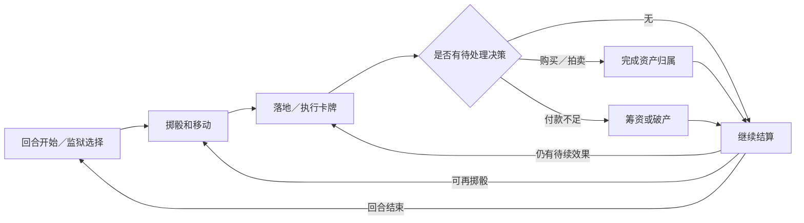

# 强手棋：经典 Monopoly 接入分析

状态：强手棋规则、电脑、界面与 OSS 图片／音效已实现，已加入注册表并默认下架。管理员上架前玩家不可见。应用尚未发布或部署。当前验收与复现步骤见 [强手棋 README](../../games/monopoly/README.md)；下文保留分析及分阶段开发记录，各阶段的「尚未完成」仅描述该阶段。规则及初始代码核对日期：2026-10-12；代码基线：`82f527c154a5da14a0aae2d52865b26da6e437f1`。

用户已确认采用经典 Monopoly，包含买地、收租、拍卖、建房、抵押和破产；图片采用经典桌游风格，尽量使用可获取的原版图片并配中文文字；图片和声音素材都必须上传阿里云 OSS。游戏继续放在同一个代码仓库，以独立模块验证后续多款游戏并行开发的边界。

## 1. 规则版本与首版范围

建议固定 Hasbro C1009 说明书作为首版基线。官方英文站点目前下载的是英国地名版本，文件印刷编号为 `0622C1009780`，PDF 创建于 2022 年。不能依据 URL 中的 `en-us` 把地图认定为美国版。中文地名、地产数据和卡牌文本应对应同一套组件。

来源：

- [官方产品说明页](https://instructions.hasbro.com/en-us/instruction/monopoly-board-game-for-ages-8-for-2-6-players-includes-8-tokens-tokens-may-vary)。
- [C1009 官方 PDF](https://instructions.hasbro.com/api/download/C1009_en-us_monopoly-board-game-for-ages-8-for-2-6-players-includes-8-tokens-tokens-may-vary.pdf)：2 页，15,316,484 字节；SHA-256：`8fc0456e50b6ad872628f904ca04aad5b7a57982a90047664c8620c221daf8be`。两页均已提取文本、渲染和查看。
- [早期官方说明书](https://www.hasbro.com/common/instruct/monins.pdf)：仅用于版本差异核对；SHA-256：`64efc7430379cf30a61b9d73a741be6872ede0c86c837c9f25b112138564e94a`。其中所得税可选择 200 或资产的 10%、拍卖可任意起价，不能混入本次 C1009 规则。

### 已核对的 C1009 规则

| 范围 | 首版规则依据 |
| --- | --- |
| 开局 | 2～6 人，每人 1,500；各掷两骰决定先手，从最高者开始 |
| 组件 | 28 张地产证、各 16 张机会和公共基金卡、32 座房屋、12 座旅馆 |
| 移动 | 顺时针移动，经过或停在起点领取 200；直接入狱不领取经过起点奖励 |
| 双骰 | 双骰相同可再次行动；连续第三次相同直接入狱，不执行第三次移动 |
| 买地与拍卖 | 无主地产必须购买或拍卖；拍卖从 10 起价，每次至少加 1，不按座位轮流；无人出价则留在银行 |
| 租金 | 依地产证计算；整组街道的空地租金翻倍；抵押地产不收租，同组未抵押地产仍可享有加成 |
| 车站与公用事业 | 车站按持有数量收租；公用事业重新掷骰计算，持有一处乘 4，两处乘 10；卡牌特殊效果另按卡面核对 |
| 建房 | 集齐色组即可建设，无须等到自己回合；均衡建房，每块最多 4 座房屋；整组各有 4 座后才可逐块升级旅馆 |
| 建筑库存 | 旅馆升级归还 4 座房屋；多人争买最后的房屋或旅馆时拍卖；库存耗尽不能凭空补发 |
| 出售与抵押 | 建筑半价卖回，均衡拆除；抵押或交易某块街道前，先卖掉该色组全部建筑；赎回支付抵押额加 10% |
| 交易 | 可交换地产、现金和免狱卡；建筑不直接交易；受让抵押地产须立即赎回，或先支付抵押额的 10%，以后赎回仍按赎回价支付 |
| 监狱 | 回合开始付 50 或用免狱卡，随后正常掷骰；也可尝试双骰相同脱狱，最多尝试 3 回合；第三次失败付 50 后按本次点数移动；双骰脱狱没有额外回合 |
| 狱中权利 | 仍可收租、竞拍、建房、抵押和交易 |
| 税与停车场 | 本版本所得税 200、另一税格 100；免费停车无奖励 |
| 卡牌 | 抽顶牌并执行，完成后放回牌底；免狱卡持有至使用或转让，使用后归还对应牌堆 |
| 破产 | 先筹资清偿，无法偿还才出局；欠玩家与欠银行分别处理资产、抵押费用及免狱卡；归还银行的地产立即拍卖 |
| 胜利 | 最后未破产的玩家获胜；不以现金最多或达到固定回合数代替 |

首版还应包括双边交易、电脑玩家与托管、观战、重连、重启恢复和结算记录。停车场奖金、玩家贷款、免租协议、起点双倍奖金和限时资产排名均不纳入默认规则。

### 尚需补齐的规则证据

说明书只展示少量地产证和组件图，没有完整的 28 张地产数据与 32 张事件卡文本。开发前须取得同版组件资料，逐项记录来源、卡牌 ID、价格、租金档位、抵押值和效果；不能从旧版或其他地区版拼成一套。

另需明确：先手最高点并列时的重掷；银行缺少 4 座房屋时旅馆降级出售；多人同时请求有限建筑的判定窗口；卡牌逐人付款引起的连续破产；银行拍卖资产与只剩一位玩家时的结束顺序。未找到同版依据的边界应列为本站补充规则，不能写成已核实的官方规则。

## 2. 线上操作与减少等待

以下是线上实现建议，需与官方规则说明分开呈现。

| 场景 | 建议交互 |
| --- | --- |
| 普通收租、税款、起点奖励 | 自动计算和结算，显示金额、原因和动画；现金不足才打开筹资面板。纸质规则要求主动索租且有截止时机，自动收租属于本站线上约定 |
| 无主地产 | 只有落地玩家选择购买或拍卖；现金不足时依合法筹资操作判断，不能让无效购买按钮阻塞流程 |
| 拍卖 | 同一个公开竞价面板，合法竞买者可随时出价；无须全桌逐个确认。无合法加价能力者只看进度，不能只凭当前现金为零就忽略其可能的合法筹资能力 |
| 拍卖结束 | 无新出价一段时间后落槌，临近截止出价保留短暂应答时间；具体时长由实际联机验证确定。无合法竞买者直接结束；自愿不竞价不触发托管 |
| 交易 | 由发起者提交给指定玩家，只通知接收者；其他玩家继续查看棋盘。过期或拒绝不逐个征询其他玩家 |
| 抵押受让 | 接收者在接受交易时选择赎回或保留抵押，提前显示全部费用；不能先交割一半再发现手续费不足 |
| 欠款 | 仅欠款玩家进入筹资流程，明确债权人、应付和缺口；提供合法卖房、抵押和交易途径；无可行筹资行为时允许明确完成破产 |
| 出局 | 结算完本人遗留责任后可以观战或离桌，不再收到掷骰、拍卖或托管操作提示 |

官方允许回合外建房和交易。需要在服务端定义可管理资产的时机及其与掷骰的先后关系：同一批动作按提交顺序原子处理，骰子产生后不得追溯改变本次落地应付租金。动画不能决定规则时序。有限建筑出现竞争时应进入竞购窗口，不能仅以网络最快者抢到最后一栋。

## 3. 独立模块与公共接口

按 [游戏开发约定](../game-development.md) 组织，目标目录如下；服务端、测试与来源清单已创建，前端及媒体素材仍待实现：

```text
games/monopoly/
  server/                 # 数据、规则、动作、视图、机器人、存档版本
  web/                    # module.tsx、棋盘、资产面板、拍卖、交易、音效映射
  tests/                  # E2E 场景、夹具、浏览器验收与素材校验
  assets/                 # 素材清单、准备脚本、来源记录；成品媒体放 OSS
  README.md
```

后端只依赖 `internal/gameapi`，在 `games/registry.go` 注册；前端沿用 `module.tsx` 自动发现。租金、银行、交易、竞拍、债务和机器人估值均留在本游戏。无需导入其他游戏实现或增加共享金融引擎。

实际代码检查发现以下边界，不能承诺完全不改宿主：

| 现有位置 | 已有能力或缺口 | 最小接入方向 |
| --- | --- | --- |
| [模块契约](../../internal/gameapi/module.go) | 私有快照、动作、视图、名次、结果详情足够承载玩法 | 优先使用现有能力；规则数据由游戏持有 |
| [模块执行](../../internal/server/modules.go) | 认证、版本、幂等键、事务和广播已具备 | 拍卖、交易自行核验窗口令牌与当前资源；仅对同一窗口允许旧版本动作 |
| `Match.Deadline` | 必须有 `TimeoutActors`；超时会把相关真人持续设为托管 | 增加可选系统定时回调及独立截止时间，用于落槌、提案失效；以持久化窗口 ID 保证重启和重复调度只执行一次 |
| [通用牌桌提示](../../web/src/game-api/host.tsx) | 所有 `Actors` 都被显示为「等待行动」；可操作不等于必须操作 | 增加可选待决策席位提示，或模块提示组件；后端仍用 `Actors` 验权 |
| `runModuleBot` | 当前选择行动列表中第一个电脑；回合外操作扩大列表后可能长期占用调度 | 游戏优先排列必须处理的玩家，并收敛可选电脑动作；若仍有饥饿，增加通用公平调度能力，用 E2E 证明必要性 |
| [离桌处理](../../internal/server/server.go) | 进行中的房间一律拒绝离桌 | 增加可选的席位参与状态／离桌许可；宿主只执行模块确认后的离桌 |
| 离桌与历史 | 已有 `Left` 可保留席位编号，但无真人时会清空席位 | 保留开局名册、历史和名次；允许出局者加入新桌；处理房主转移及剩余全电脑局，不能只删除离桌限制 |
| [声音入口](../../web/src/audio.ts) | 目前只有合成音；全局按旧动作类型映射提示音 | 通用层只负责音量、解锁和播放基础能力，强手棋自行映射素材及游戏事件；避免与宿主回合／结束音重复播放 |

新增能力应可选且保持旧模块默认行为。验证目标是既有六款游戏规则文件无需为强手棋改变；公共层只理解定时、参与状态和提示，不认识「地产」「无钱」「抵押」等概念。

## 4. 状态与并发设计

建议用持久化阶段与待续效果队列组织规则：



快照需要保存玩家现金、位置、监狱状态、地产归属及建筑、有限建筑库存、两副牌堆顺序及免狱卡持有者、双骰次数、当前阶段、债务对象、拍卖及交易窗口、暂停前的计时预算、出局顺序和随机状态。读视图和机器人选动作都不能推进随机源；骰子和洗牌不能接受客户端指定结果。

资金用整数。每笔转账必须注明付款人、收款人和原因；银行收支单独记账，不能用「所有玩家现金总额不变」作为守恒条件。房屋、旅馆、地产与卡牌分别检查库存或唯一归属。

欠款保存为债务，不能简单扣成负数后自动淘汰。欠款可能暂停卡牌中的后续逐人支付，破产后还要处理受让人的抵押费用。全过程须能重连和重启继续，不能在一次临时函数调用栈里保存进度。

交易提案包含双方、资源、版本和失效条件。接受时重新验证现金、归属、建筑限制与费用，再原子交割；修改提案使旧确认失效；同一地产不能通过两个并发提案重复卖出。竞价也必须防止重复扣款、截止后出价和旧拍卖请求污染下一场拍卖。

游戏按最后生存者确定冠军，其余建议按出局先后确定名次；同时出局的排序须明确。净资产可作为结算详情，不能替代经典胜利条件。平台继续沿用自身积分政策。

## 5. 图片、音效与 OSS 发布

### 素材范围与来源

用户选定经典桌游风格。优先获取与规则版一致的原版组件图，保留原图比例和配色，中文名称与规则用可读文本叠加。官方 PDF 已确认有棋盘透视图、部分地产证、房屋和旅馆、部分棋子；这些展示图不等于完整可用的高清棋盘、全部棋子和卡牌素材，缺项需要继续获取并核验。

| 素材组 | 首版交付范围 | 接入方式 |
| --- | --- | --- |
| 入口与棋盘 | 游戏封面、棋盘底图、起点／监狱／停车场等格子图形 | WebP 底图配 SVG／HTML 交互区域；地图坐标独立维护，移动端可缩放并打开格子详情 |
| 玩家与建筑 | 至少支持 6 人同时区分的棋子、房屋和旅馆 | 透明 WebP，保留原版棋子外观；叠加玩家标记与建筑数量 |
| 地产证 | 28 张地产的显示素材与规则数据映射 | 可复用原版牌框／色组装饰，名称、价格、租金和抵押值由经核对的数据绘制 |
| 事件卡 | 两种牌背、32 张卡对应的原版插画或完整卡面、免狱卡 | 中文文本单独呈现；同版共用插画可以复用文件，逐卡记录对应关系 |
| 状态与金额 | 货币、抵押、拍卖、狱中、破产和胜利的视觉提示 | 图形加文字，不能仅凭颜色传达状态 |
| 操作音效 | 掷骰、走格、经过起点、购买、收租／付款、抽牌、建房、抵押／赎回 | 独立短音频；高频走格节流，避免多人事件叠成噪声 |
| 流程音效 | 拍卖开始／竞价／成交、交易完成、入狱、轮到自己、破产、胜利 | 根据已提交的游戏事件播放；刷新、重连和重复广播不重播旧事件 |

当前没有已核验的 Monopoly 音频包。声音拟使用有明确来源的可用录音／音效，或制作并导出独立音频文件；逐项记录来源和处理方式，不将现有合成提示音当作音频素材已完成。背景音乐与语音播报不作为首版必需项。

成品素材清单记录逻辑 ID、相对路径、源 URL／源文件摘要、提取位置、加工方式、权利归属／许可信息、文件 SHA-256、字节数；图片另记尺寸和透明度，声音另记格式、时长、采样率和声道。可下载不代表素材来源记录已经完整；不能用其他版本图片冒充同版组件。

### 已有管线与必要补充

- [素材部署约定](../assets.md) 已使用 `ASSETS_BASE_URL` 与版本化 OSS 路径；新游戏沿用实际基地址，在其下增加 `monopoly/v1/images/` 和 `monopoly/v1/audio/`。不能为了强手棋改变其他游戏的素材根路径。
- [现有上传脚本](../../scripts/upload_assets.py) 仅扫描 `*.webp`，校验 WebP 文件头并设置一年不可变缓存。目前无法上传音频，需要先写针对性校验再扩展明确支持的格式和 MIME 类型。
- 建议图片用 WebP；短音效至少提供兼容性较好的 MP3，必要时增加 Ogg。格式选择必须经目标浏览器实际解码验证。开发期源文件、转换输出、缓存和校验报告全部放仓库 `.local/monopoly/`。
- 游戏目录维护准备脚本和素材清单；媒体成品通过 OSS 发布。实际域名与密钥沿用私有配置，不写进游戏代码、清单或上传日志。
- 发布使用新版本目录或新文件名，不覆盖不可变缓存对象。素材版本与游戏版本分别记录；回滚游戏时应仍能访问旧素材。

### 发布与验收流程

1. 补齐同版素材来源和逐项清单，生成缩略图总览；检查裁切、透明边缘、棋子辨识度和手机文字。
2. 生成图片和音频，核对摘要、类型与解码；声音检查削波、首尾爆音、时长和音量，并实际试听。
3. 从私有部署配置核对实际 OSS 前缀，上传清单中全部成品；图片、声音都属于交付范围。
4. 从页面实际使用的 CDN 地址逐项 GET 回读，核对字节、摘要、MIME、缓存和浏览器解码。使用跨域 Web Audio 时检查 CORS；按播放方式验证需要的 Range 支持。
5. 用真实页面触发掷骰、收租、拍卖、建房和结束事件，验证画面与声音对应；保留网络校验报告、截图、触发日志及试听结果。静音自动化运行只能证明触发和解码，不能代替试听结论。
6. 验证首次用户交互解锁声音、静音／音量持久化、重复广播去重、切桌停止旧音效，以及 CDN 失败时仍可操作。回退图形用于容错，正式验收仍要求 OSS 素材成功加载。

图片和音效按场景加载，不能让整个素材包下载阻塞开局。棋盘与当前棋子优先加载，牌面和低频音效按需缓存。现有全局声音开关需覆盖新模块，不额外出现互相矛盾的两套开关。

## 6. 开发前的失败场景与 E2E 验收

复杂规则先编写失败场景和可失败的 E2E，再实现代码；不在实现后补单元测试。上传格式、金额等简单独立逻辑如需隔离验证，也先列失败场景和写针对性检查。下表是首批场景，不代表测试已经执行。

| 场景 | 要证明的行为／失败防护 |
| --- | --- |
| 2／4／6 人正式开局 | 设置校验、初始现金与组件正确，所有玩家和观众看到对应视图 |
| 双骰、入狱、出狱 | 第三次双骰不移动；双骰脱狱不额外行动；第三次失败先付钱再按已保存骰子移动 |
| 买地与无人竞价 | 不购买进入拍卖；无人竞价正确流拍；无关玩家没有确认弹框 |
| 多人竞价 | 同价并发、旧版本、重复 nonce、截止瞬间加价、客户端断线均不重复成交或扣钱 |
| 系统计时 | 落槌只发生一次；不竞价不会转托管；重启后恢复正确截止时间 |
| 建筑与抵押 | 非均衡建设／出售、抵押组建房、带建筑交易均拒绝；32 房屋／12 旅馆不增殖，短缺拍卖与降级边界正确 |
| 交易并发 | 双重出售、资产变动后接受、修改后旧确认、抵押费用不足不造成部分转移 |
| 欠款与破产 | 能合法筹资者不提前淘汰；欠银行与欠玩家分别结算；继承抵押费用与多人卡牌可继续执行 |
| 出局与历史 | 破产者离桌后可加入新桌；旧局保留身份和名次；房主离桌及仅剩电脑不丢档 |
| 隐私和越权 | 观众和对手无法读取牌堆顺序、随机状态、私有提案；不能代别人行动或指定骰子 |
| 重启恢复 | 在拍卖、欠款、交易接受、卡牌待续、结算各阶段重启，结果与正常运行一致 |
| 电脑与托管 | 可选交易不占满调度；无无限竞价或管理动作循环；多种固定初始条件完成到自然胜利 |
| 素材与声音 | 漏文件、错误类型、CDN 缓存旧内容、CORS／解码失败可识别；静音有效，事件去重，弱网不阻塞操作 |
| 页面与兼容 | 1440、390、320 像素宽度可完成关键操作；交易和地产信息可读；六款已有游戏接入行为保持正常 |

游戏内提供只在测试服务可用的确定性夹具或随机源，正常客户端无此入口。E2E 通过真实认证、房间 HTTP／WebSocket 和浏览器动作完成关键链路；夹具局必须标记，不能当作从开局完成的完整对局。

计划将可重复执行的入口放在 `games/monopoly/tests/`。产物保存到 `.local/monopoly/acceptance/`，包含运行命令、Git 版本、规则／素材版本、种子或初始快照、各场景断言、动作轨迹、终局摘要、浏览器截图、服务日志及 OSS／CDN 校验结果；CI 上传这些产物。历史失败不能只通过删除报告消失。最终还需完成 [现有模块接入检查](../game-development.md#开发和验证)。

## 7. 建议开发顺序与完成标准

1. **规则和素材定版**：补齐地产／卡牌数据、完整原版图片及声音来源；先建立失败场景、素材清单与准备流程。
2. **高风险接入样例**：先写「拍卖 → 欠款 → 破产离桌 → 重启继续」E2E，再实现最小状态和必要宿主能力。验证游戏独立边界，不以只有掷骰走格的原型证明完整接入。
3. **规则闭环**：实现监狱、卡牌、交易、建筑库存、抵押和债务续接；完成电脑／托管与自然终局 E2E。
4. **完整视听界面**：棋盘、资产面板、拍卖、交易、筹资与结算；完成素材制作、图片和音效 OSS 上传及 CDN 校验，接入手机操作和声音设置。
5. **发布验收**：完整对局、恢复、并发、隐私、旧游戏回归与真实素材播放通过，保留可重复产物后才进入版本发布。

并行开发可按服务端规则、前端交互、素材与声音、E2E 验收分工，但先固定本游戏动作／视图和素材 ID。公共接口修改集中在第二步完成，之后各方向主要修改 `games/monopoly/`，以此验证「同仓库、少公共部分」的目标。

调研阶段完成了官方说明书和现有模块／素材管线核对。完整组件目录、图片音频成品、OSS 上传及强手棋游戏 E2E 均尚未完成；开发进度另记如下。

## 8. 开发记录

### 2026-10-12：系统事件与出局离桌

先列失败场景并编写 [宿主 HTTP E2E](../../internal/server/module_events_e2e_test.go) 和 [快照契约检查](../../internal/gameapi/module_events_test.go)，保留接口未实现时的失败输出后再实现。

新增可选 `SystemDeadline`／`OnTimer`、`Attention` 和 `Eliminated`。系统事件独立于玩家超时托管，在事务中提交快照、审计与结算；失败保留旧状态，过期时间未推进则拒绝提交。出局玩家可以离桌加入其他牌桌，原局保留席位和名次，最后真人离桌后电脑仍可完成对局。界面按必要操作提示等待，显示出局／离桌状态，并关闭出局者托管入口。旧模块未提供新字段时保留原行为。

已通过：

- 事件重启恢复与单次提交、回调失败／数据库写入失败的原子性、出局者越权拒绝、出局离桌／房主转移／另开牌桌、原局战绩与积分、最后真人离桌后的电脑结算。
- 无电脑、无 WebSocket、无手动推进时钟的真实定时器 E2E。
- 新场景、原模块生命周期与超时、旧游戏离桌／空闲关闭相关场景的定向竞态检查。
- 前端 265 项测试；既有模块接入浏览器脚本的 16 个检查点，包含六款游戏的桌面与手机页面、测试模块完局与刷新。浏览器使用测试模块，不代表强手棋界面或完整玩法已验证。

复现命令（先执行 `. scripts/env.sh`，产物均在仓库内）：

```sh
mkdir -p .local/monopoly/acceptance/host
go test -race -json -count=1 -timeout=3m \
  -run 'Test(EventEnvelopeValidation|ModuleSystemEvent|ModuleLastHumanDeparture|ModuleRegistrationAndLifecycle|ModuleBotAndTimeout|Legacy|.*Departure|.*Inactive|.*Idle)' \
  ./internal/gameapi ./internal/server \
  > .local/monopoly/acceptance/host/race.jsonl
npm --prefix web test
python3 -B scripts/accept_game_modules.py
```

原始失败输出、成功输出、自然时钟验证和 HTTP 场景快照保存在 `.local/monopoly/acceptance/host/`。浏览器结果与截图保存在 `.local/module-refactor/browser/`。下一步继续补齐同版数据和素材，并以这些宿主能力实现强手棋的实际拍卖、欠款、破产与恢复场景；目前不能创建强手棋牌桌，也尚未上传图片或音频。

### 2026-10-12：强手棋经济与移动流程

新增独立的 [强手棋模块](../../games/monopoly/README.md)，服务端只依赖 `internal/gameapi`，未导入其他游戏或旧引擎。先编写 [经济 HTTP E2E](../../games/monopoly/tests/economy_e2e_test.go) 和 [移动 HTTP E2E](../../games/monopoly/tests/movement_e2e_test.go)，保留缺少模块／行动时的失败输出，再实现规则。

已实现并验证：

- 2／4／6 人自然开局、随机先手、初始资金与组件、观众越权拒绝、重启恢复。骰子随机源及牌堆顺序保存在私有快照中，客户端不能提交骰子或随机种子。
- 购买、强制转拍卖、同一窗口旧版本报价、重复请求、无效报价原子拒绝、自动落槌与流拍、拍卖重启恢复；拍卖参与者不显示为必须回应，也不因落槌转托管。
- 抵押筹资后自动清偿；欠玩家时转移资产并由受让人处理抵押费用；欠银行时解除抵押、逐项拍卖；出局后离桌另开牌桌；最后生存者结算与重启保持。
- 经过起点、色组空地租金、抵押地不收租、同组部分抵押时仍保留其他地产加成、车站数量、公用事业单独掷骰、税款和免费停车。
- 连续第三次双骰直接入狱；普通双骰在购买结束后继续掷骰；双骰出狱不奖励额外回合；第三次出狱失败的费用不足时暂停，筹资后按原骰子移动；付费或免狱卡出狱后的正常双骰规则。

在整数资金账目下补充了单笔抵押费用向上取整约定，并先用 HTTP 场景验证 175 抵押值对应 18 利息、193 赎回价。该约定与自动收租一样，应在最终线上规则说明中明确。

最终本轮 35 项测试及子场景通过竞态检查，另通过全部 Go 包编译、强手棋包 `go vet` 和七款游戏依赖边界检查。复现命令：

```sh
. scripts/env.sh
mkdir -p .local/monopoly/acceptance/economy
go test -race -json -count=1 -timeout=3m ./games/monopoly/tests \
  > .local/monopoly/acceptance/economy/final-race.jsonl
go test -run '^$' ./...
go vet ./games/monopoly/...
python3 -B scripts/check_game_boundaries.py
```

失败记录、最终测试输出和每个场景的公开快照保存在 `.local/monopoly/acceptance/economy/`；自然开局和中局夹具在报告中分别标注。当前棋盘数值来源与核验范围记录在 [素材及数据来源清单](../../games/monopoly/assets/sources.json)，完整同版组件证据仍待补齐。

尚未完成事件卡效果、建设／拆除和建筑短缺拍卖、玩家交易、完整电脑策略、强手棋界面与浏览器验收、图片音频制作和 OSS 发布。当前落入事件格会拒绝尚未实现的流程，因此不能运行完整对局，仍未注册生产入口。不能将本轮中局验收写成完整强手棋完成。

### 2026-10-12：建筑、交易和筹资托管

先编写 [建筑 HTTP E2E](../../games/monopoly/tests/buildings_e2e_test.go)、[交易 HTTP E2E](../../games/monopoly/tests/trade_e2e_test.go) 和 [资产管理托管 E2E](../../games/monopoly/tests/management_bot_e2e_test.go)，保存失败输出，再实现对应规则。这轮业务代码均留在强手棋目录，没有继续扩充共享游戏引擎。

建筑流程覆盖均衡建造与出售、旅馆升级归还房屋、旅馆降级消耗四座房屋、最后一座房屋／旅馆的公开竞价，以及银行库存不足时的整组出售。建筑竞价保留暂停前的阶段和操作时间，并验证重启后正确恢复。筹资可以出售建筑或抵押其他地产，但不能破坏最高报价所依赖的建设条件。

建筑竞买资格按可行筹资能力计算：不能把待建色组的抵押价值算入竞价资金；竞购旅馆时不能通过卖掉升级所需的四座房屋来假定资金充足。无实际筹资途径的玩家不会进入 `auctionActors`，仍可查看拍卖或参与其他合法交易，不会被当作欠回应者。

双边交易可交换现金、地产及免狱卡。提案仅双方可见，一个玩家保留一份自己发出的提案；编辑生成新编号，旧批准无效。接受时重核归属、资金、抵押状态及全部费用，一次性交割；收到的现金可用于支付受让费用，再继续清偿既有债务。提案不锁资产，多个提案不能重复出售同一地产；抵押状态变化需要重新报价。无关版本变更和回合切换不会使仍有效的不可变提案失效。

提案到期与拍卖截止共用宿主系统调度入口，但各自保留截止时间；一个先到期后，另一个仍会执行。提案失效不触发托管，也不延长当前玩家时限。电脑补充了基于公开资产估值的接受／拒绝，以及欠款时出售建筑的基础策略，尚不代表完整电脑策略已完成。

验证记录：

- 整批 57 项测试及子场景通过竞态检查，包含之前的经济／移动场景及新建筑、交易、托管场景。
- 随后补充不可行建筑筹资的资格检查；先观察新增 E2E 失败，再修复，并通过相关建筑、酒店、拍卖和并行计时器的定向竞态回归。
- 全部 Go 包编译、强手棋包 `go vet` 和七款游戏依赖边界检查通过。

可复现命令与原始输出：

```sh
. scripts/env.sh
mkdir -p .local/monopoly/acceptance/trade-buildings
go test -race -json -count=1 -timeout=4m ./games/monopoly/tests \
  > .local/monopoly/acceptance/trade-buildings/race.jsonl
go test -race -json -count=1 -timeout=2m \
  -run 'TestMonopoly(.*Build|Hotel|OffTurn|.*Auction)' ./games/monopoly/tests \
  > .local/monopoly/acceptance/trade-buildings/eligibility-race.jsonl
```

场景快照继续保存在 `.local/monopoly/acceptance/economy/`，新阶段的测试输出、失败记录与验证摘要保存在 `.local/monopoly/acceptance/trade-buildings/`。当前仍未完成事件卡效果、完整电脑局、界面、媒体素材和 OSS 发布；还需验证完整对局中的连锁破产及终局结算顺序，不能提前开放游戏入口。

### 2026-10-12：事件牌、连锁结算与完整自动局

读取 [Monopoly Land 的分年代卡表](https://www.monopolyland.com/list-monopoly-chance-community-chest-cards/)，逐项核对 16 张英国版机会卡与 2021 年后的 16 张公共基金卡。它是二手卡表资料，不冒称 Hasbro 官方完整卡面。初始代码参考中的贫困税牌属于旧组合，没有沿用；两张最近车站牌分别保留独立 ID。新版公共基金文案采用社区活动主题，金额与效果按所列卡表录入，来源与文件摘要写入 [sources.json](../../games/monopoly/assets/sources.json)。

先写 [事件卡 HTTP E2E](../../games/monopoly/tests/cards_e2e_test.go)，再实现抽牌、归还牌底、免狱卡离堆／持有／交易／归还、移动触发新格子、最近车站双倍租金、最近公用事业重新掷骰乘十、房屋与旅馆分别计算修缮费，以及多人收付款的持久化待续队列。快照校验每副牌的 16 张实体卡恰好分别位于牌堆或持有者手中一次。

连锁场景验证了付款者破产后余下义务取消、当前债权人接收资产、收款者因抵押受让费破产后不再继续收款，以及重启后的准确续接。明确采用线上终局顺序：转移最后一位破产者的资产后直接宣布唯一生存者获胜，不再开启已经不影响胜负的受让收费或银行拍卖。

先写 [电脑投资与完整局 E2E](../../games/monopoly/tests/full_game_e2e_test.go)，再补充按公开租金收益建造、保留现金缓冲、赎回成组地产和发起补齐色组的交易。每个自己的回合限制一次主动提案，避免反复报价占住调度；报价按合法金额加价，避免逐块游戏币反复竞价。

三场完整 HTTP 自动对局从每人 1,500、全部地产无主、完整牌堆及起点位置开始，使用固定服务器随机源与牌序，实际提交相同机器人策略产生的动作，均经过自然破产结算：

| 人数 | 合法动作数 | 建造动作 | 成交交易 | 破产人数 |
| --- | --- | --- | --- | --- |
| 2 | 435 | 59 | 1 | 1 |
| 4 | 547 | 61 | 4 | 3 |
| 6 | 597 | 54 | 5 | 5 |

三场都在第 300 步附近重启服务，并在终局后再次重启核对战绩。多个检查点替换私有随机状态和未揭示牌序，机器人选择保持一致。完整初始测试快照、所有动作与统计保存在 `.local/monopoly/acceptance/full-games/players-{2,4,6}.json`。这些测试由认证测试账号直接驱动策略以加速验证，不代表生产定时器节奏或真人浏览器完整体验。

整批 110 项测试及子场景通过竞态检查，随后补验同一行动两次向前经过起点应领两次奖励、直接入狱不领取跨起点奖励，相关八项测试及子场景通过。全部 Go 包编译、强手棋包 `go vet` 和依赖边界检查通过。复现：

```sh
. scripts/env.sh
mkdir -p .local/monopoly/acceptance/cards
go test -race -json -count=1 -timeout=7m ./games/monopoly/tests \
  > .local/monopoly/acceptance/cards/final-race.jsonl
go test -race -json -count=1 -timeout=40s \
  -run '^TestMonopolyCardChainAndSpecialRentHTTP$' ./games/monopoly/tests \
  > .local/monopoly/acceptance/cards/go-boundaries.jsonl
```

素材进展：通过 `pdfimages -png` 从固定摘要的 C1009 官方 PDF 提取并查看了原版封面、房屋、旅馆和英国版透视棋盘；对象编号、尺寸和提取文件摘要已记入来源清单。它们尚未转换为网页成品或上传 OSS，六种棋子与音频仍需准备。

还需完成界面、真实浏览器操作和完整联机体验、图片及声音制作、OSS 上传和 CDN／播放验收，并补足地产表剩余数据的同版证据。另一个地产介绍页的正文存在两处租金冲突，已记录且未据此覆盖现有数据。当前不开放强手棋入口，也没有发布或部署。


## 当前实现：界面、素材与默认下架

已完成中文 40 格棋盘、地产证、交易编辑与接受、拍卖、筹资、监狱、观战、出局离桌和手机缩放。服务器提供合法操作提示，前端不复制经济规则。宿主仅补充必要操作提示、出局席位、独立系统时钟，以及通用的音效开关和时间基准。

新游戏统一默认下架，通过管理员后台显式上架；直接创建接口同样检查上架状态。已有六款游戏保留历史默认值和显式上下架设置。强手棋已注册但没有在生产环境上架。

图片和声音使用现有素材基地址下的 `monopoly/v1/`：20 张 WebP、11 个 MP3，已上传 OSS 并逐个核对实际 CDN 字节、MIME 和解码结果。图片来源包括 C1009 官方说明书组件和单独标注的经典棋子插画；卡牌采用类别插画与中文文字。记录来源不等于获得新的再分发许可，也不把第三方插画称作官方组件照片。地产数据仍保留其实际核验范围。

新增浏览器验收覆盖默认隐藏、后台点击上架、玩家创建、1440／390／320 像素布局、交易和资产操作、图片解码、实际音频播放、静音、刷新不重播，以及音频请求失败时操作仍成功和随后播放恢复。产物位于 `.local/monopoly/acceptance/browser/`；素材回读记录位于 `.local/monopoly/acceptance/assets/cdn/`。完整运行命令及规则执行约定见 README。
