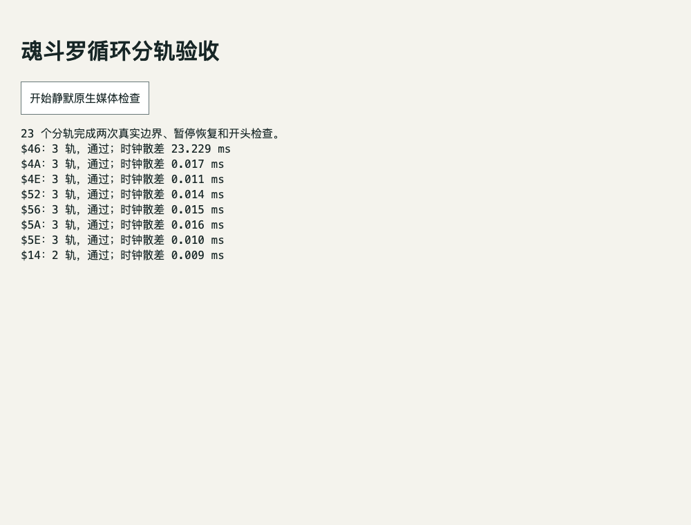

# 旋律分轨的循环派生与验收

已为日版魂斗罗 7 首 BGM 的 pulse1、pulse2、triangle 和 Intro 持续效果 `$14` 的 pulse1、pulse2，共 23 个旋律分轨生成循环候选。**原周期、原样前奏和主体 PCM 保持不变，只在尾部 1,411 个样本内作公开记录的接缝处理。** 数值接缝及单轨原生媒体循环边界已通过；多轨采样级同步、实际混音和听感未通过验收，未发布资源。

可消费清单为 [audio-loops.json](../../../games/contra/assets/audio-loops.json)。`loopReady` 的范围仅是「PCM 数值接缝＋每轨原生后缀循环行为」，不等于发布、听感或完整游戏音频验收。清单仍保留 `acceptedForRelease: false`、`multiTrackSyncAccepted: false` 和 `listeningAccepted: false`。

## 先验证原始边界

输入来自已排除 120 tick 冷启动瞬态的原录与分轨。源 WAV、驱动状态、PCM 游标均先按 SHA-256 复制到私有快照，再开始搜索，避免并行素材工作覆盖输入。

实现前列出的失败场景包括：把驱动状态重复误认为波形相位相同、错误扣除预热偏移、改变周期、同组周期不一致、尾部简单淡出到静音、局部能量抵消、产生新脉冲或削波、改动前奏／主体，以及把数值通过扩大成混音通过。验证器先对未加工候选执行检查，**最初 21 轨中 20 轨未通过**，[原始 red 结果](evidence/audio-loop-raw-red.json)保留每轨的边界与能量测量。新增 `$14` 的两轨也均未通过，[Intro red 结果](evidence/audio-loop-intro-raw-red.json)与[扩展前失败场景](evidence/audio-loop-intro-plan.md)单独保留。

## 接缝方法和范围

每组声音使用全部旋律轨共同的驱动帧切点：音乐为三轨，`$14` 为两轨。只在原始重复周期内向后搜索，同时要求：

- 起止的完整 130 字节驱动状态相同。
- 后续一个完整周期的逐帧驱动状态也一致。
- 起止 PCM 游标之差严格等于原候选的周期样本数。
- 同组全部轨道在同一切点通过固定数值门槛，不分别改节奏或隐藏不合格轨。

令 `start/end` 为扣除预热后的源 PCM 位置，`N=1411`。最后一段采用升余弦权重：

```text
w(i) = (1 - cos(pi * i / (N - 1))) / 2
tail(i) = round((1 - w(i)) * source(end - N + i)
                + w(i) * source(start - N + i))
```

输出仍有 `end` 个样本，不移除重叠区，也不添加样本。`[0, end-N)` 与源 PCM 完全相同；尾部连接到 `start` 之前的真实样本，而不是衰减为零。媒体到达文件末尾后从 `loopStartSample=start` 恢复，所以前奏仅播放一次，周期保持 `end-start`。

1,411 个样本在 44.1 kHz 下为约 31.995 ms。没有变速、重新合成音符或整体音量归一化。每份文件先独立生成两次，再在另一个进程重复生成，23 个输出 SHA 完全一致。

| 声音 ID | 共用切点相对原候选后移 | 媒体后缀起点 | 保持的周期 |
| --- | --- | --- | --- |
| `$46` | 50 tick | 2.445964 秒 | 2,183,764 样本／2,976 tick |
| `$4A` | 26 tick | 10.033469 秒 | 1,408,880 样本／1,920 tick |
| `$4E` | 17 tick | 22.662676 秒 | 1,408,880 样本／1,920 tick |
| `$52` | 168 tick | 3.710567 秒 | 950,993 样本／1,296 tick |
| `$56` | 1 tick | 11.214875 秒 | 1,017,035 样本／1,386 tick |
| `$5A` | 7 tick | 19.301542 秒 | 1,972,432 样本／2,688 tick |
| `$5E` | 0 tick | 22.379819 秒 | 1,540,962 样本／2,100 tick |
| `$14`（Intro） | 4 tick | 0.232948 秒 | 82,185 样本／112 tick |

这些是媒体接缝锚点，不替代原音序的循环起点。控制器仍使用原打击乐时间表；媒体保留原样前缀并使用相同周期，绝对音乐相位没有因此改写。

## 数值检查

[数值报告](evidence/audio-loop-numerical.json)、[共同切点搜索记录](evidence/audio-loop-search.json)、[音乐独立重复生成结果](evidence/audio-loop-repeat.json)及 [Intro 独立重复生成结果](evidence/audio-loop-intro-repeat.json)保留完整数据。验证器重新读取输出，检查实际 PCM，而不是信任生成器的 `passed` 字段。

- 接缝相对原始相邻样本的边界误差不超过 1；最后 16 个样本相对真实前缀尾部的误差不超过 1。
- 8 ms 窗口、2 ms 步长的局部 RMS 与两段原声的加权能量比较，固定门槛为 ±2 dB。实际范围约为 −1.817 到 +0.172 dB；Intro 两轨边界及最后 16 样本误差均为 0。
- 一阶跳变与二阶差分峰值均不超过原相邻源段的 105% 加量化余量；没有削波。
- 除规定尾部外的前奏和主体逐样本相同，同组周期样本数相同。

门槛在派生前已固定，没有为某首歌降低要求。共同切点搜索成功后才输出候选。

## 真实原生媒体检查

使用生产 `GameAudioPort.track`、真实 Chromium `HTMLAudioElement` 和本次 WAV，通过 agent-browser 的独立会话检查。浏览器 profile、缓存、socket 和临时服务器均位于工作区；使用静默输出，不向扬声器播放。

23 轨分别完成两次「尾部 → 指定后缀」边界，合计 46 次；每组还检查暂停保持位置、恢复后继续推进、从零开始保留前奏，以及离开时停止。新增验收逐组检查全部 8 组前缀，包含不足 1 秒的 Intro 前缀；最初版本只抽查第一组前缀。使用 HTTP Range 服务和实际文件内容，没有使用音频播放 mock。

[最终原生结果](evidence/audio-loop-native-summary.json)、[完整逐帧／事件记录](evidence/audio-loop-native.json.gz)和 [两个运行的完整历史](evidence/audio-loop-native-history.json.gz)均已保留。第二轮脚本修正了「取最后一次边界」的汇总问题，改为取两次最大值；旧样本也重新计算并保留，未丢弃较差值。

追加 Intro 前的 7 曲清单、数值结果及原生结果保存在 [prior acceptance](evidence/audio-loop-intro-prior-acceptance.json.gz)。扩展前后这些音乐的 PCM、摘要、周期和前缀参数一致；新增回归使用包含 `seekTrack` 的生产音频实现，实际受测 SHA 记录在清单 `nativePlatformSHA256` 中，采样前后检查源码未变。

历史 21 轨验收的最大同曲三轨媒体时钟散差为 **23.235 ms**，边界最大时钟推进欠差约为 **33.800 ms**。本次 23 轨两轮验收分别保存在 [Intro 原生回归历史](evidence/audio-loop-intro-native-history.json.gz)，合并观察的最大同组散差为 **23.233 ms**，最大边界时钟推进欠差约为 **29.333 ms**。这些量来自 rAF 与媒体 `currentTime` 的对照，不是捕获的输出 PCM 缺口。测试中预设的 150 ms 条件只用于拒绝明显卡住，不能当作「无缝音频误差」门槛。

因此，`nativeBoundaryReady` 证明指定后缀位置和播放状态可用，不证明多轨采样级同步或实际输出无间隙。适配层的共同时间锚点、显式 resync、实际混音及设备听感仍须继续验收。



## 清单接口

```text
format: contra-j-audio-loops-v1
sampleRate: 44100
songs[]:
  id
  kind（可选；Intro 为 loop-effect）
  loopStartSample / decodedSamples / periodSamples / periodTicks
  loopStartSeconds / periodSeconds
  pcmSeamReady / nativeBoundaryReady / loopReady
  nativeMeasurements:
    crossTrackClockSpreadMS
    tracks[]: channel / nativeEnds / maximumBoundaryClockDebtMS / positions
  stems[]:
    channel / file / sha256 / sourceFile / sourceSHA256 / blendSamples
```

`file` 是工作区内候选路径，不是线上 URL。前端可以按 SHA 不可变清单或本地验收 URL 注入资源，不能把这些本地路径当正式回退。noise／DPCM 没有在本任务中硬循环，它们继续由原始打击乐事件和优先级处理。

## 复查与清理

```sh
python3 -B scripts/contra/audio_loop_snapshot.py
python3 -B scripts/contra/audio_loop_verify.py --probe-raw  # 原始候选的预期 red
python3 -B scripts/contra/audio_loop_derive.py
python3 -B scripts/contra/audio_loop_verify.py
python3 -B scripts/contra/audio_loop_browser.py --label new-run
python3 -B scripts/contra/audio_loop_finalize.py --browser new-run

# 只追加或重新生成 Intro，保留其他七曲：
python3 -B scripts/contra/audio_loop_snapshot.py --ids 20
python3 -B scripts/contra/audio_loop_verify.py --probe-raw --ids 20
python3 -B scripts/contra/audio_loop_derive.py --ids 20
```

浏览器验收前的清单及其 SHA 已保留。验收后只增加 readiness、证据链接和测量字段，实际媒体文件与被测循环参数没有改变。

已核对父任务原始输入 SHA 后删除约 242.81 MiB 私有快照；独立重复生成文件完成字节比较后用硬链接去重约 83.14 MiB。生成器始终原子替换输出，并在比较前确认两份生成物没有共享可写 inode，避免后续重跑因归档硬链接而假通过。验证器可直接回读未修改的父任务原录，清理后再次通过。[清理范围](evidence/audio-loop-cleanup.json)仅包含本任务文件，未修改原始 WAV、用户 ROM 或其他任务产物。

Intro 扩展的最终来源绑定、保留项和新增清理范围见 [audio-loop-intro-verification.json](evidence/audio-loop-intro-verification.json)。原版导出脚本与 `audio-source.json` 未由本任务修改。
