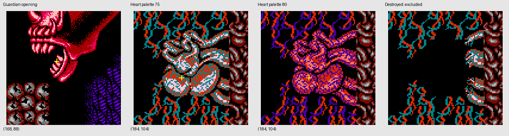
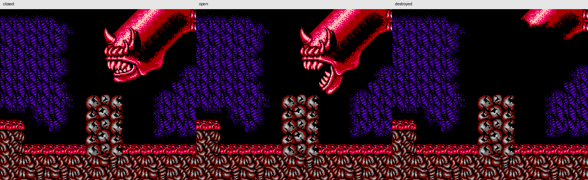
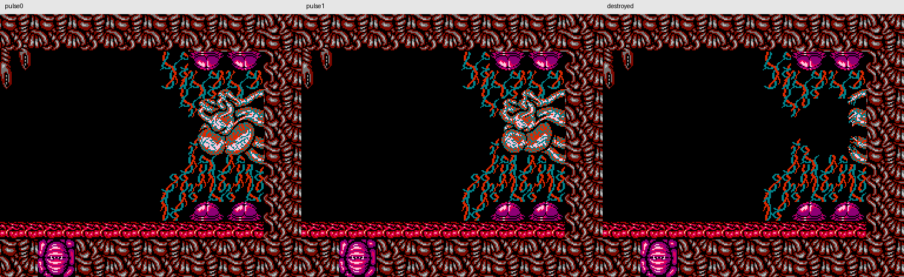

# 第 8 关背景目标的固定视觉配方

`BotAlienBackgroundVisionRecipes()` 提供守卫开口与心脏核心两条配方，共 3 个图案码。它们表示画面中可尝试瞄准的视觉目标；`enemy` 不承诺仍存活、剩余 HP 或当前可受伤。死亡演出尚未替换背景时，同一完整图案必须产生相同观察。

本项只增加独立配方、前置测试和原版图案证据，未改规则、策略、公共构造器或其他配方。全局知识聚合由公共视觉任务接入。配方无运行时参数，`Level=7`、`Alternate` 只选择固定素材来源，不根据当前隐藏关卡筛选知识。标签不声明 `Stage`、`Scene`、`Choice` 或规则阶段。

可见类别分别为 `Family="alien-guardian"`、`Family="alien-heart"`，兼容编号为 `Kind=16/22`。类别来自独特图案，不是从当前场上实体读取类型；它也不额外声明存活或伤害资格。

## 配方与可见锚点

| 外观 | 固定来源 | 裁剪 `(x,y,w,h)` | 原图内锚点 `(x,y)` |
| --- | --- | --- | --- |
| 守卫张开的口腔 | 第 8 关普通图形，更新 `0x12` | `(0,8,32,24)` | `(8,24)`，上下颌之间的可见开口 |
| 心脏核心，两种跳动外观 | 第 8 关 alternate 图形，更新 `0x07/0x0B` | `(8,0,24,24)` | `(24,8)`，下左区域的可见核心 |

坐标来自图案的可见结构，没有读取敌人槽位或将隐藏实体坐标传给识别器。在原版固定地图布局中，测试观测到的锚点分别为 `(168,88)`、`(184,104)`；它们只用于验证裁剪与图案原点，运行时位置仍由像素匹配产生。



守卫闭口的 `0x10/0x11`、共用上颌的 `0x13`、身体装饰及残骸 `0x15..0x17` 不作为独立弱点证据。原版 `0x11` 与 `0x13` 的上半部逐像素相同，不能据这部分图案判断嘴是否张开；因此选区排除共用额头与上颌。心脏残骸 `0x0C..0x0F` 也不作为完整核心候选。

## 合法图形与调色上下文

原版日版 ROM SHA-256 为 `6ba53139fa88b8de1ae527c438bda6f1541d1ee7df26d63dec5164a32d166bfe`。脚本重新核对原始超图块、属性、地图、头部、CHR preset、动画页表与颜色表的字节区间，并直接从 ROM CHR 位平面生成像素。图案预期不由待测配方生成。

- 守卫使用普通 preset 7。原版 CHR 动画与调色共形成 16 组固定上下文，选定开口裁剪在这些上下文中逐像素相同；无需用当前动画时刻选模板。
- 心脏使用 alternate preset 17。两种图案各有 palette 组 3 的 `75/80` 两种颜色；选区在四个 CHR 动画页阶段中相同。公共构造器的 alternate 调色展开已覆盖这两种颜色。
- 这些原版 `0x8x` 绘制请求保留已有属性。守卫所在格为 `$55`，心脏四格为 `$FF`；完整目标的更新条目恰好与保留属性相同。心脏残骸的表内属性为 `$CF/$3F/$FC/$F3`，负样本仍必须使用真实保留的 `$FF`，不能按表内属性制造一种不存在的残骸外观。

现有 schema 足以表达这两条裁剪。它们没有自行构造新的 CHR／调色组合，也没有扩大公共 `AppearanceVariants` 行为。公共构造器处理的其他闪光背景与其他 Boss 家族，仍归公共视觉范围验证。

复用了已有 REA 入口 `$B4A1/$B50A/$B522/$B5AB/$B6D7/$BCD9/$BD71` 和原版绘制调用。具体 Evidence ID、原始素材摘要、CHR 页摘要和调用来源保存在 `testdata/bot-alien-original-art.json.gz` 及 [验证记录](evidence/bot-alien-recipes-verification.json)。受控心脏规则录制在初始场景中执行，只用于确认请求码／绘制语义；本项心脏的实际图形上下文另由原版 alternate 头部和最终场景地图确定。

## 验证结果

独立参考包含 175 个图案、24 组素材上下文、1,224 个完整图案光栅和 18 个重建场景。正常引擎包的三项限定 race 检查覆盖：

1. 配方图案与原版字节一致；所有选定外观都能由真实 `buildBotBackgroundVisionTemplates` 构造，裁剪和合法颜色完整。
2. 8 个完整目标场景识别出正确可见锚点；10 个闭口或残骸场景不产生目标。相同像素不会因未知关号值变化而改变候选。
3. 共用上颌的实际同图歧义被保留，配方不使用它消歧；修改返回切片不会污染下一次全局知识。





这些图片是原版字节的独立素材重建，不是自然 Boss 战截图。前置 red、最终正常包 race、源码摘要与重复导出一致性均已保留；完整电脑战役、全局模板之间的组合与所有遮挡情况不由本组局部配方测试替代。

```sh
.local/board-art-env/bin/python -B scripts/contra/bot_alien_reference.py
python3 -B scripts/contra/bot_alien_verify.py
```

只清理本项中间图片、重复日志和测试临时目录，保留原版 fixture、最终研究图与 red／green 结果，见 [清理记录](evidence/bot-alien-recipes-cleanup.json)。用户 ROM、其他任务目录和公共构造器未改写。
