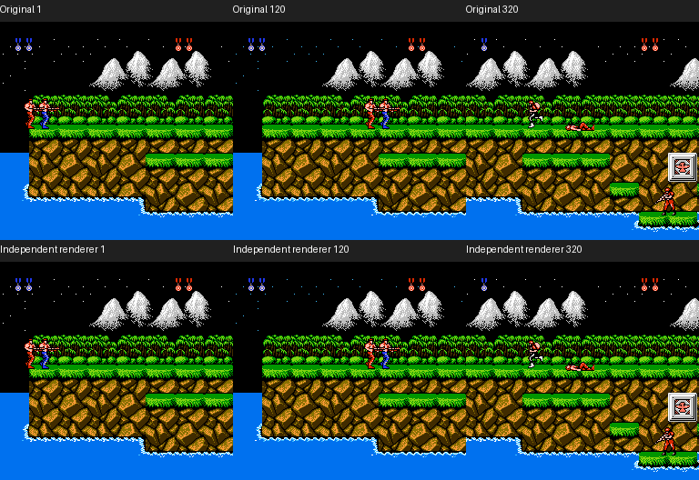

# 地图数据与独立场景绘制

2026-10-25：第一关地图已进入独立 Go 引擎，背景及精灵组合已进入纯 TypeScript 绘制层。代码不执行 ROM、CPU 指令或服务端游戏结果；这一步验证了数据解释和绘制，尚不代表独立八关游戏完成。

## 第一关数据

`scripts/contra/export_jungle.py` 从固定日版 ROM 读取已核验的数据范围，生成 `games/contra/engine/leveldata/jungle.json`。正式引擎仅嵌入约 10 KiB 的地图定义，包含 108 个超图块、13 个不同屏幕及 1 个前瞻别名，不包含整个 ROM 或程序 bank。源文件范围、命令与 SHA-256 保留于旁边的 `jungle-source.json`。

`JungleScreen` 返回独立可修改的屏幕副本，用于后续地图破坏和加载；修改一局的图块不会改变另一局的源数据。解压器处理原版的字面值、重复值和行复制，检查截断、越界及未初始化的复制来源，并返回实际消耗的字节数。

先写失败场景及测试，再实现。验证包括 14 个指针项的完整静态解码、自然录制的首屏图块／属性／碰撞、第二屏已写入的左半区，以及第 2 屏的真实后续解码。[验证记录](evidence/level-implementation-verification.json)明确区分静态解码范围与原版实际经过范围。

## 完整画面合成

`games/contra/web/background.ts` 接收规范化的图块、属性、索引图案页、调色板和镜头状态，输出背景像素及遮挡掩码。它与 `sprites.ts` 的精灵层合成，保留在水中等情况下的背景优先级。两个模块均不修改输入状态，也不负责敌人、碰撞、生命或胜负。

原版录制实际观察 `$2005` 的水平／垂直滚动写入和 `$4014` 的 DMA，避免拿下一帧 RAM 当作当前显示状态。13 个样本各有恰好一组 X/Y 滚动写入，DMA 与显示帧相同；覆盖水平滚动 0、37、77、98、136、231 以及 11 个实际 CHR 页。

完整合成结果与原版截图的 **798,720 个像素逐一相同**。同时验证了 256 像素水平边界、240 像素垂直边界、属性象限、通用背景色、左侧裁剪、前后景优先级及输入缓冲不变。两个独立运行的完整 RAM、滚动记录和 DMA 字节一致。



上排是原版截图，下排由独立绘制函数根据同帧捕获的状态数据生成。下排不是截图裁剪或视频播放，也不是已完成的独立游戏：玩家、敌人和弹丸状态仍来自此次原版观测。完整规则与联机验收需要后续独立状态推进。

[绘制验证记录](evidence/scene-implementation-verification.json)保留 red／green、类型检查、来源摘要与复查命令。可重新执行：

```sh
node --experimental-strip-types --test games/contra/tests/background.test.mjs
node --experimental-strip-types scripts/contra/render_scene_proof.mjs
```

## 八关原版初态

`scripts/contra/capture_stage_entries.py` 已观察八关的原版初始化。每次自然开机后，只在 `$CC5F` 首次执行且 `$18=5、$2C=0` 时，将 `$30` 设置为目标关号；此入口早于敌人准备、CHR 选择及 `$A816` 头部加载。之后不补写位置、生命或游戏结果。

这是明确的受控起点，不是自然通关证据。每关在 `$A84A` 返回前读出的 32 字节 RAM 头部均与 ROM 原表一致；到正常场景后，部分字段会被原版复用或用于调色循环，记录保留这些变化，不强行要求整段 RAM 永远等于初始表。

[八关初态记录](evidence/campaign-controlled-entries.json)绑定每次改写、原版源摘要、快照及正常场景状态。阶段 2、4 是基地，阶段 3 是纵向瀑布，其余为横向场景。第 4 关记录时第二位角色已被原版敌人击中并进入死亡状态，未篡改为存活。

初态位于 `.local/contra-campaign/states/stage-{1..8}-v2.fcs`，供后续隔离验证室内、纵向、武器与敌人行为使用。不能把第一关的指针表长度推断套到其他关：基地有多组透视地图引用，瀑布的指针顺序也不同。其他关卡的完整规则、地图经过及最终结果仍待验收。

本轮只清理了自身重复录制、首次头部比较探针及临时绘图缓冲，保留正在使用的原版初态。用户 ROM、其他游戏和并行任务文件未修改。
