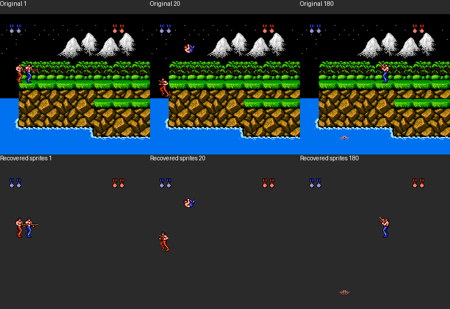

# 日版魂斗罗精灵恢复

本项恢复角色及弹丸的图块、元精灵拼装与实际 OAM 输出，供独立 Canvas 呈现使用。输入绑定日版 ROM SHA-256 `6ba53139fa88b8de1ae527c438bda6f1541d1ee7df26d63dec5164a32d166bfe`。原版模拟器仅为开发验证环境。

## 实现前失败场景

- 把美版地址、CHR-RAM 或 8×8 精灵解释直接套用日版。
- 把 `$0200` 的下帧 CPU 缓冲误认成当前画面的 DMA 数据，产生一帧错位。
- 忽略日版实时 CHR 换页，导致正确 tile 编号读到错误图案。
- 忽略 8×16 tile 低位的图案表选择、水平／垂直翻转、透明色或 OAM Y 加一。
- 元精灵共享指针、紧凑弹丸格式、调色板覆盖、后坐力偏移或屏边裁剪解释错误。
- 只裁剪截图代替可复用元精灵；只观察站立帧却声称全部动画已恢复。
- CPU 属性与实际 PPU palette 不一致；把颜色近似值当原始调色板数据。
- OAM 优先级轮转和每扫描线限制导致误判图块、左右角色或可见像素。

先保存原版自然执行中元精灵函数的输入／输出、实际 DMA、CHR 页及截图，再编写解码与差分验证。验证范围以实际记录为准，未覆盖的关卡、武器与动画保留缺口。

## 已恢复范围

2026-10-25：完成日版元精灵拼装和第一关自然操作的实际 DMA／像素对照。保留了 255 个元精灵描述、1,145 个图块部件、角色动画表及全部 128 个 CHR 页的来源；其中 14 个元精灵代码得到本轮自然运行验证，不能把结构解码范围扩大成全部动画或八关的验收范围。

| 验证 | 结果 |
| --- | --- |
| 原版 `$9284` 拼装调用 | 607 次；逐次比较完整 256 字节 OAM、写入游标和剩余量，全部一致 |
| 普通元精灵／紧凑弹丸 | 分别 480 次／127 次 |
| 实际 DMA 像素 | 15 帧、13,409 个不透明前景像素，与原版截图逐像素一致 |
| 角色动画输入／输出采样 | `$A4F8` 自然调用 480 次，保留前后语义字段；尚未实现完整状态选择器 |
| CHR 解码 | 128 页、8,192 个 8×8 图块，共 131,072 字节；全部往返编码与 ROM 一致 |
| 只读钩子影响 | 增加动画采样前后，240 帧完整 RAM 轨迹字节一致 |
| 留存证据复查 | 从 `sprites-natural.json.gz` 重新验证，607 次 OAM 及 15 帧像素再次通过 |



上排为原版完整截图，下排是从原版实际 DMA、CHR 和调色板数据独立解码的精灵层，没有使用截图裁图。背景地形由另一个恢复任务处理；这里不把透明区域或背景遮挡部分计入像素通过数。

## 日版地址与数据格式

NMI 在 `$F8CE` 装入 PRG `$14/$15`（实际 8 KiB bank 4/5），随后 `$F8D1` 调用 `$919F`。分析片段为 `$9167..$BFFF`，对应原 ROM 文件偏移 `16 + $9167`。这一数值对应关系仅对本 bank 4/5 映射成立，不是通用 CPU 地址到 ROM 偏移公式。

| 日版地址／字段 | 作用 |
| --- | --- |
| `$919F` | 常规精灵绘制；通过 `$07EB & 1` 选择轮转路径或 `$9167` 线性路径 |
| `$9167` | 线性 OAM 写入，步长 4；本轮自然采样未进入此路径 |
| `$9284` | 将一个元精灵转换成 OAM 条目 |
| `$936E` | HUD 精灵入口 |
| `$93DA` | 代码 1 开始的指针表；代码 128 的表位置为 `$94D8` |
| `$95D8` | 第一个元精灵数据；本轮按 255 个代码解析指针，全部落在合法 bank 范围 |
| `$0300..$0319` | 26 个逻辑精灵代码；前两个是玩家 |
| `$031A+x`／`$0334+x`／`$034E+x` | 逻辑精灵 Y／X／属性 |
| `$0200..$02FF` | 待提交的 CPU OAM 缓冲；它可以属于下一帧，不能直接当当前画面的 DMA |

`$9284` 的 Evidence 为 `ev_2f218342a95095a283756cb84332b996e4ddfce574df551045a457719d4c0533`，完整内容见 [REA 原始证据](evidence/sprites-rea.json.gz)，派生汇编与数据定位见 [索引](evidence/sprites-index.json)。

元精灵分三种格式：

- 首字节 `00`：空精灵。
- 首字节 `FE`：一个紧凑图块，后面两个字节为 tile 与属性；相对坐标为 `x−4、y−8`。普通弹代码 `$1E` 位于 `$9770`，属于此格式。
- 其他首字节：部件数量；每个部件按 `dy、tile、attribute、dx` 四字节排列。部件开头的 `80` 是共享数据跳转，后面两字节给出新地址，不消耗部件数量，并停止后续部件的后坐力偏移。

常规属性 bit 2 决定是否覆盖部件调色板；bit 5 处理背景优先级，bit 6／7 水平／垂直翻转。bit 3 会给未进入共享数据的部件增加一像素 Y 偏移，用于后坐力。翻转位置使用原版 `$F8−dx`／`$F0−dy` 的字节运算，不能只翻转图片而保留原部件坐标。

原版先写 OAM 的 Y、tile 和属性，再判断 X 是否越界。被裁剪的最后一个部件可能留下部分槽位，随后由外层填充隐藏。差分工具保留这一顺序，避免只比较可见图块时掩盖游标或裁剪错误。自然记录中 OAM 步长均为 `$C4`；线性步长 4 的分支只有静态恢复证据。

## CHR、调色板和画面时序

本轮第一关场景实测 `PPUCTRL=$B0`，精灵使用 8×16 模式：tile 编号低位选择图案表，其余位指向两块连续 8×8 图块。Y 坐标按 OAM 规则增加 1；逐扫描线按 OAM 顺序保留前 8 个精灵，并处理左右翻转、透明色和左侧 8 像素开关。

15 份实时 PPU 快照中的 8 个 1 KiB CHR 窗口逐字节匹配原 ROM 页 `[1,4,6,7,68,69,70,71]`。动态颜色使用原版 PPU palette 色号；RGB 转换表由录制 FCEUX 的 `gui.parsecolor` 读取，不自行近似红蓝色。其他关卡或场景的 CHR 页组合仍需分别记录。

录制钩子在写 `$4014` 时读取实际提交的 OAM，单独保存当前控制寄存器、显示帧号及 PPU 内容。截图对应的 15 帧均有同帧 DMA 记录；像素重绘不借用该帧结束后已经改写的 `$0200` 缓冲。像素比较排除 behind-background 部件的遮挡判断，未声称完成整个 PPU 或背景渲染。

## 角色动画与属性入口

| 地址 | 静态恢复 |
| --- | --- |
| `$A4F8` | 调用 `$A551` 选择角色精灵，再进入属性更新 |
| `$A4FB` | 处理隐藏、出生无敌闪烁、电击／无敌调色板、背景优先级、后坐力和翻转，写入逻辑精灵缓冲 |
| `$A551` | 优先检查水中、踏空、跳跃，再按场景类型与动画序列分派 |
| `$A583` | 按瞄准方向／后坐力选择跑动序列，每 8 tick 推进一格，6 格循环 |
| `$A5EC` | 死亡动画每 8 tick 推进，最终停在第 5 格 |
| `$A629` | 按瞄准方向设置水平翻转 |
| `$A638` | 跳跃卷身，每 5 tick 推进一格，4 格循环；朝向与帧决定水平／垂直翻转 |
| `$A677`／`$A7A1`／`$A7FC` | 水中／室内／室内 Boss 动画选择，保留静态证据；完整分支仍需逐项动态覆盖 |

已提取的原版数据表：

| 表 | 日版地址 | 值 |
| --- | --- | --- |
| 站立／上举／趴下 | `$A57E` | `0F 16 17` |
| 跑动，持枪在手 | `$A5CE` | `02 03 04 05 03 06` |
| 跑动，向前持枪 | `$A5D4` | `0D 0E 0F 0D 0E 0F` |
| 跑动，斜上瞄准 | `$A5DA` | `10 11 12 10 11 12` |
| 跑动，斜下瞄准 | `$A5E0` | `13 14 15 13 14 15` |
| 室内跑动 | `$A5E6` | `51 52 53 51 52 53` |
| 死亡代码／翻转 | `$A61B` | `(0A,00) (0B,00) (0A,C0) (0B,C0) (0C,00)` |
| 跳跃卷身 | `$A673` | `08 09 08 09` |

水中路径还会更新 Y、水平速度和水中阶段，不能当成只换图片的纯视觉函数。后续规则移植须把这些副作用纳入状态机；本轮只保存了 480 次入口／返回的语义采样，没有将整个选择器写入游戏引擎。

## 产物与复查

- [sprites-catalog.json.gz](evidence/sprites-catalog.json.gz)：255 个元精灵、部件属性、动画表及 CHR 页摘要，供后续独立呈现读取。
- [sprites-natural.json.gz](evidence/sprites-natural.json.gz)：完整自然操作的函数输入／输出、实际 DMA、PPU、RGB、截图和原始输入脚本，各文件有 SHA-256。
- [sprites-rea.json.gz](evidence/sprites-rea.json.gz)：16 个入口的完整 REA Evidence bundle；[sprites-index.json](evidence/sprites-index.json) 提供阅读索引与结果统计。
- `.local/contra-sprites/assets/chr/page-000.png` 至 `page-127.png`：每页 64×64 的索引色图块图，像素值 0／1／2／3 表示调色板索引。只生成本地素材，未发布 OSS；不能把灰度预览当正式配色。

## 独立前端呈现数据层

已实现 [`games/contra/web/sprites.ts`](../../../games/contra/web/sprites.ts)，只接收规范化元精灵、CHR 像素页、调色板和逻辑位置，不执行 ROM，不访问网络、DOM 或音频。

| API | 作用 |
| --- | --- |
| `parseSpriteCatalog` | 校验来源 SHA、描述格式、唯一代码和部件范围；保留原版逻辑位置为锚点，不按每帧图片重新居中 |
| `appendSpriteOAM` | 将部件应用到复制的 OAM 数据，保留共享部件的后坐力边界、翻转、调色板覆盖、裁切及原版写入顺序 |
| `decodeChrPage` | 将 1 KiB 双位平面解码为 64×64 调色板索引图；正式资源可直接供应同布局 PNG 的索引像素 |
| `resolveSpriteRow` | 绑定 8×16 的图案表低位、上下两个 tile、垂直翻转及对应 CHR 页 |
| `rasterizeSpriteOAM` | 生成固定 256×240 RGBA 精灵层和前景优先级掩码，供后续 Canvas 与背景合成；每扫描线按原版保留前 8 个精灵 |

OAM 内层拼装函数会完成当前元精灵后才由外层停止，即使剩余计数已变成负值。代码与边界测试保留这一行为，最终硬件输出仍严格限制为 64 个四字节条目。没有把任意大精灵列表当成无限制绘制队列。

[`sprites.test.mjs`](../../../games/contra/tests/sprites.test.mjs) 在实现前先因模块不存在失败，随后 7 项测试通过；原版 607 次函数输出和 15 帧像素来自独立录制夹具，不由实现生成。附加边界覆盖紧凑弹丸屏外写入、OAM 游标环绕、共享部件后坐力停止、8×16 奇数 tile、垂直翻转、扫描线上限、左侧裁切和缓冲不变性。附加边界是依据日版字节与图形格式的人工构造，未伪称为新增原版自然对局。

前端原版夹具与来源在 `games/contra/tests/testdata/sprites-original*`，可通过 `sprites_export_web_fixture.py` 从保留的原始证据重新生成。资源来源清单位于 [`games/contra/assets/sprites-source.json`](../../../games/contra/assets/sprites-source.json)。目前没有公开资源 URL 或注册游戏；资源发布仍需后续统一的不可变 OSS 流程。

```sh
node --experimental-strip-types --test games/contra/tests/sprites.test.mjs
node web/node_modules/typescript/bin/tsc --noEmit --target es2022 --module esnext --moduleResolution bundler --strict --lib ES2022,DOM games/contra/web/sprites.ts
```

只复查已保留证据，不启动模拟器：

```sh
.local/board-art-env/bin/python -B scripts/contra/sprites_verify.py --evidence docs/research/nes-contra/evidence/sprites-natural.json.gz
```

从原 ROM 重新采样，需要先由 `capture_bootstrap.py` 建立自然双人初态；随后使用新的任务输出目录，避免覆盖旧记录：

```sh
python3 -B scripts/contra/sprites_prepare.py
node scripts/contra/sprites_rea.mjs .local/contra-sprites/sprite-spec.json
CONTRA_REFERENCE_ROOT="$PWD/.local/contra-sprites/replay" .local/board-art-env/bin/python -B scripts/contra/sprites_capture.py natural-sprites
.local/board-art-env/bin/python -B scripts/contra/sprites_verify.py .local/contra-sprites/replay/runs/natural-sprites
.local/board-art-env/bin/python -B scripts/contra/sprites_export.py .local/contra-sprites/replay/runs/natural-sprites
```

Python decoder 的 red 检查同样先于实现：验证脚本最初因缺少 `sprites_decode` 失败，再实现解码并通过原版差分。没有修改游戏规则引擎、前端注册、用户 ROM 或其他任务文件。未知范围包括未观察代码的实际用途、其他武器／关卡、完整水中与室内阶段、全部颜色特效和整个游戏画面。
