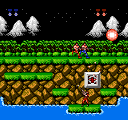

# 日版武器与玩家弹丸

本项恢复了普通枪、M、F、S、L 及 R 增速的生成与弹丸更新规则，代码位于 `games/contra/engine/weapons*.go`。实现使用命名状态和数据表，不执行 ROM 或模拟 CPU。原版与受控调用分别保留，不能把子系统验证算作自然拾取或八关通关验收。

## 来源和调用顺序

ROM SHA-256 固定为 `6ba53139fa88b8de1ae527c438bda6f1541d1ee7df26d63dec5164a32d166bfe`。日版固定桥 `$FA12` 把 PRG bank 12／13 映射到 `$8000/$A000`，再进入 `$8001` 检查射击；弹丸更新入口为同 bank 的 `$8584`。运行钩子核验 `$8000` 的 bank 标识为 `$1C`，避免把其他换页的相同地址误记为武器调用。

玩家阶段顺序是瞄准、脚下状态、射击、动作／位移、精灵阶段。`FireRequest.X/Y` 必须使用本帧移动前的角色锚点。射击函数只回写玩家的 `MachineGunTimer`（`$AC+x`）和 `Recoil`（`$CE+x`）；弹丸归 `WeaponSystem` 的 16 个槽位所有。伤害、敌人生命与胜负不由此模块直接决定。

REA 保留 57 个武器 bank 片段及两个固定 bank 辅助函数，包含汇编、调用和完整 Evidence。入口与数据表地址可在 [索引](evidence/weapons-index.json)、[武器表](evidence/weapons-tables.json)、[武器 REA](evidence/weapons-weapon-rea.json.gz) 和 [固定辅助 REA](evidence/weapons-fixed-rea.json.gz) 中复查。公开美版反汇编只用于寻找候选语义，实际地址、音效值、算术和表都以日版字节及原版执行为准。

## 已实现语义

| 内容 | 日版行为 |
| --- | --- |
| 射击前置条件 | 屏外 Y 高字节或电击计时非零时直接返回；在水中时禁止 Aim 3–6 的向下方向 |
| 普通枪／F／S | 只在 B 新按边沿尝试发射；持续按住不重复触发 |
| M／L | 使用 B 按住状态，继续执行各自的节奏与槽位规则 |
| 未触发射击 | M 计时去掉高半字节；低半小于 7 才递增，达到 7 后保持；后坐力不变 |
| 普通枪／F | 搜索 4 个候选槽；P1 从 0 开始，P2 从 10 开始 |
| M | 搜索 6 个候选槽；使用原版低半 8／15 阈值及高半累计规则；没有空槽时计时设回 7 |
| S | 一次最多创建 5 颗，按剩余空槽可以部分创建；P1 搜索 0–9，P2 搜索 6–15，重叠槽不能覆盖活跃弹丸 |
| L | 创建 4 个延迟启动段；新按 B 可重建本方范围，持续按住则等待其 4 个槽全部空闲；强制采用增速表 |
| 跳跃向下射击 | 跳跃状态下 Aim 4／5 转为弹丸方向 11，再查枪口和速度表 |
| 室内 | 使用原版独立枪口、向屏内收束速度、倒计时和武器缩放／旋转规则；趴射保留 Kind 的 bit 7 |
| 弹丸清除 | 清除武器、图像、速度和阶段等字段，但保留 X／Y 和二者的小数累计；不能直接把整个结构清零 |
| 命中 | `Projectile.Hit()` 对应 `$E2FE`，设 `Routine=2、Timer=6`，由后续更新显示命中特效并回收 |

原版音效码为普通枪 26、M 28、F 38、S 40、L 36。这些是事件码，由平台音效映射处理；武器代码没有播放器或静音开关。

普通飞行的水平镜头修正每次减 1，延迟中的 L 段则减完整滚动字节；竖向时加滚动字节。该差异有日版 REA 依据。后续纯按键 M 拾取记录已验证水平滚动量 0／1；非零竖向滚动仍需后续世界 E2E 覆盖。

`BulletStep.Terrain` 的契约是原版完整实体背景探测，包括地板下方实体的解释；不能不经核验就使用只读当前格的简化判断。当前样本的实体碰撞开关均为 0，此路径只有静态来源依据，尚未作原版动态验收。

## 先测后写的验证

`weapons_test.go` 先于行为实现创建并执行 red；弹丸步进及装备轨迹用例也在 `Step` 实现前执行 red。差分直接比较原版记录的玩家字段、音效事件及完整 16 槽、336 字节对应语义状态，不在测试中用同一算法生成预期值。生成和回收时的残留小数值也参与比较。

| 证据 | 原版来源 | 通过范围 |
| --- | --- | --- |
| [自然记录](evidence/weapons-natural.json.gz) | 第一关双人初态，纯按键；无 RAM 干预 | 480 次普通枪射击检查，240 次整池更新 |
| [边界记录](evidence/weapons-isolated.json.gz) | 在 `$8001` 边界显式设置请求与槽位，执行真实函数后恢复；不是自然玩法 | 6,440 次，覆盖五武器／R、室外／基地／基地 Boss、跳跃方向、所有 M 计时值、隐藏／水中／电击、满槽与空槽边界 |
| [装备轨迹](evidence/weapons-equipment.json.gz) | 第 1／2／3 关受控初态，只在加载后设置一次 `$AA/$AB`，之后纯按键 | 9,488 次射击检查，5,391 次整池更新，覆盖五武器／R 与阶段 0／1／2 |
| [自然 M 拾取与射击](evidence/weapons-machine.json.gz) | 原版双人初态，纯按键击破第一枪盒并拾取 M；没有内存干预 | P1 第 292 帧得到 M，保持 409 帧；1,367 次射击检查、700 次整池更新，包含水平滚动 0／1 |

合计 17,775 次射击检查、6,331 次整池更新与 Go 结果一致，相关 race 测试通过。第 1／2／3 关初态来源见 [受控关卡进入说明](evidence/campaign-controlled-entries.json)；修改关号进入和设置装备都明确记录。自然 M 拾取另有纯按键证据，不能将其扩展成其他武器自然拾取或自然通关结论。

装备 30 个场景与边界场景分别重新录制，62 份 RAM／调用记录逐字节相同。自然记录增加只读 `screenCleared` 字段后重录，RAM 完全相同，所有原有调用字段相同。录像中的敌人碰撞可以修改弹丸阶段，但此项 Go 差分以每次调用的真实输入为边界；完整世界连续回放需要将敌人碰撞、玩家步进与弹丸池联调。

自然 M 记录也独立录制两次，完整 RAM 与调用记录逐字节相同。路线先用斜下射击击破低位枪盒，再沿上层平台接住弹起的 M，之后持续按 B。已有先行差分测试加入这批纯按键记录后继续通过，无需修改武器行为实现。



这是原版观察截图，不是独立游戏渲染交付。相关原始运行 `.local/contra-weapons/pickup/runs/natural-machinegun-01` 保留供敌人／道具规则联调；[最终检查记录](evidence/weapons-verification.json) 保存 red／green 和摘要。

## 接口与复查

```go
pool := engine.WeaponSystem{}
result := pool.Fire(engine.FireRequest{/* 移动前的真实玩家状态 */})
// 将 result.MachineGunTimer/Recoil 写回该玩家，按平台 audio 映射 result.Sounds。
pool.Step(engine.BulletStep{/* 原版时序中的镜头、场景与背景探测 */})
// 权威敌人碰撞成立后：
pool.Projectiles[slot].Hit()
```

开发验证脚本只写工作区。`weapons_prepare.py` 从固定 ROM 创建研究切片；`weapons_tables.py` 只生成具名数据表，原始切片不进入正式引擎。

```sh
python3 -B scripts/contra/weapons_prepare.py
node scripts/contra/weapons_rea.mjs .local/contra-weapons/weapon-spec.json
node scripts/contra/weapons_rea.mjs .local/contra-weapons/fixed-spec.json
python3 -B scripts/contra/weapons_tables.py
source scripts/env.sh
mkdir -p .local/contra-weapons/tmp
export TMPDIR="$PWD/.local/contra-weapons/tmp"
export GOTMPDIR="$TMPDIR"
go test -race ./games/contra/engine -run '^TestOriginal(Weapon|NaturalProjectile)' -count=1 -json
```

重新采样使用新的名称，录制器拒绝覆盖既有运行目录：

```sh
.local/board-art-env/bin/python -B scripts/contra/weapons_capture.py --mode natural --name natural-recheck --output .local/contra-weapons/recheck
.local/board-art-env/bin/python -B scripts/contra/weapons_capture.py --mode isolated --name isolated-recheck --output .local/contra-weapons/recheck
.local/board-art-env/bin/python -B scripts/contra/weapons_capture_equipment.py equipment-recheck --output .local/contra-weapons/recheck
.local/board-art-env/bin/python -B scripts/contra/weapons_capture_machinegun.py --name natural-machinegun-recheck --output .local/contra-weapons/recheck
```

后续缺口是其他武器的自然获得、非零竖向滚动与实体墙碰撞的动态验证、完整敌人命中／得分／死亡联调，以及八关连续对局。没有注册游戏、改写用户 ROM、提交或发布。本次仅清理本任务重复录制、旧分析迭代和 Swift／Ghidra 临时缓存；供继续联调的主录制和最终证据保留。

## 连续世界中的 S 弹状态传递

较长的首关轨迹补充了阶段单测未覆盖的依赖：室外或基地 Boss 场景中，每次成功分配 S 弹后，bank 12/13 的 `$848A` 会选择速度表，并在 `$849F` 把表指针低字节写入原版 `$06`。无 R 时是 `$F4`，有 R 时是 `$44`。该值随后可能影响敌人生成，属于既有运算的状态传递，不是新的随机数。满池未分配、不射击、射击被阻止及普通基地室内 S 弹不产生这一写入。

`FireResult.GenerationBiasChanged/Value` 现在报告该效果；`CombatPhaseResult` 汇总实际玩家调用顺序中的最终值，并在世界进入敌人／生成阶段前更新唯一 `GenerationBias`。原版完整世界第 1,736 帧首先暴露此遗漏，修复后连续对照推进到实际 Boss 死亡前。原版定位与归因更正见 [enemies-world-bias-1736.json](evidence/enemies-world-bias-1736.json)，REA 主证据为 `ev_e32dfc82418c5843f44fff7442f114609669b430d3df7f8b8dbb78225aeb575d`。同帧声音请求并不是这次状态写入的来源。
