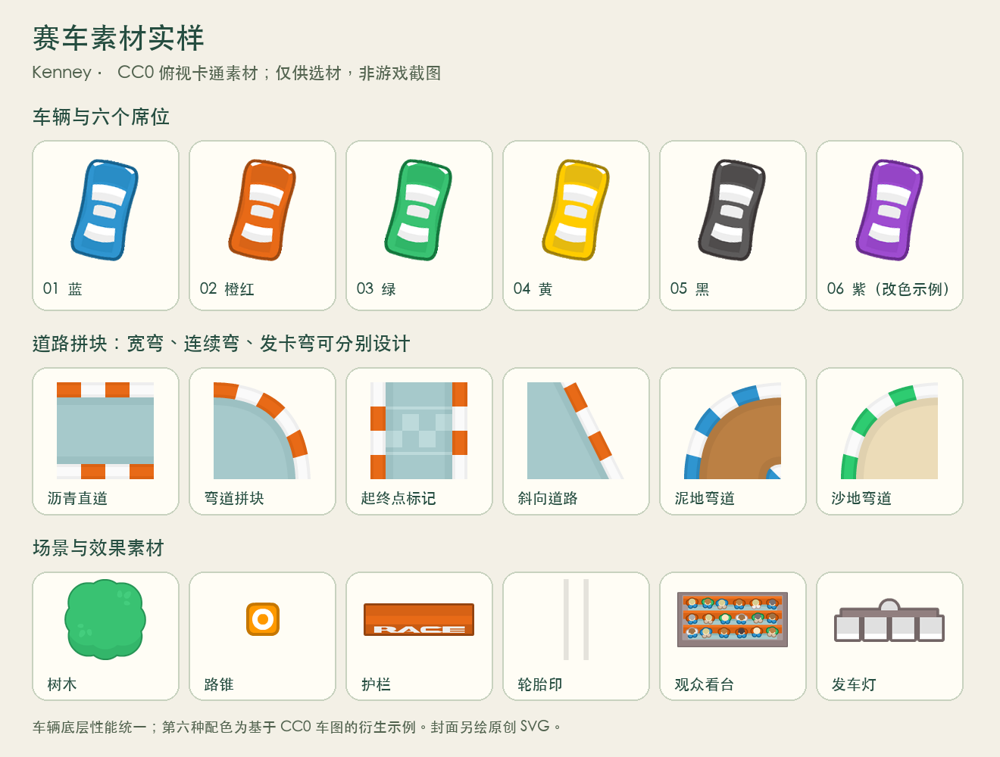

# 赛车首版：玩法与素材方案

核对日期：2026-10-15。本文保留玩法与选材确认时的记录；当前游戏实现、正式素材及验收命令见 [逐风赛车模块说明](../../games/racing/README.md)。正式素材已上传 OSS；新增游戏保持默认下架，由管理后台控制上架。下文的「尚未制作」描述属于选材阶段，不替代模块中的当前状态。

用户已确认 **2D 俯视卡通漂移竞速、跟车镜头、2～6 人含电脑、默认 3 圈且可设置、首发 3 条赛道、同性能车辆换外观，首版纯竞速**。本确认不包含攻击、防御道具；游戏名称尚未确定，`racing` 仅作为研究目录标识。

用户随后已查看实际素材预览，并确认采用 **Kenney 俯视卡通风，统一精修配色、补画独立封面**。此确认针对画风与素材路线，不表示赛道成品、动画或音效混音已经完成。

首版以完成规定圈数后的过线先后决定名次。赛车外观不改变加速、极速、抓地力或碰撞尺寸；电脑与真人使用相同车辆参数和合法输入。真人可托管、接管和重连；单人进入房间时可添加电脑满足比赛人数。比赛规则、赛道数据、物理、电脑策略与验收留在独立游戏目录。

下面是已确认方向的细化建议，不代表已经实现或经过手感验收：

| 内容 | 实施建议 |
| --- | --- |
| 三条赛道 | 分别以宽弯、连续 S 弯、发卡弯形成不同驾驶节奏。现有素材可支持林地、沙地、岩谷风格；具体路线、主题名称及美术装饰尚待制作 |
| PC 操作 | 方向键／WASD 控制油门、刹车与转向，独立漂移键；菜单操作不承担驾驶 |
| 手机操作 | 默认自动加速，滑动方向盘控制转向，独立刹车／漂移触区；支持纵向窄屏，不能只在强制横屏时可玩 |
| 镜头 | 平滑跟车并适当向行进方向前瞻；自己的车辆有清楚轮廓和编号，避免仅靠颜色辨认。缩放赛道预览如需开放，应遵循公共地图拖动／滚轮规范 |
| 路面 | 草地、砂石与赛道路面的抓地力、阻力由服务端统一模拟；路线可有分岔，但检查点必须按顺序通过，不能逆穿终点刷圈 |
| 名次与结束 | 首车完成后应给剩余车辆明确、可见的完赛期限。超时未完赛按已完成圈数、检查点和赛道进度排序；期限与圈数选项在实现前写入规则与验收 |
| 电脑 | 根据公开赛道与车辆位置规划制动、过弯、避障和超车；不直接改位置、圈数、速度或胜负 |
| 动画 | 车轮转向、车身侧滑、轮胎印、烟尘、碰撞火花与发车灯。视觉碰撞、音效和服务端结果使用同一时间轴 |

**图片主选为 [Kenney Racing Pack](https://kenney.nl/assets/racing-pack)**，官网与下载包内 `License.txt` 均明确 CC0，允许修改、商业使用和分发。已经检查原 ZIP、实际文件及矢量源；来源地址、原包和样品 SHA-256 见 [图片来源清单](racing/evidence/images/sources.json)。

该包实际包含 423 个素材 PNG 和 3 个 SVG 源文件；官网标注的 420 与 ZIP 实际数量不同。50 张车图对应 5 种配色、5 种车型和 2 档尺寸。车辆为俯视图，可以在 Canvas 中任意旋转；大版车辆约 70～71 × 116～131 像素，正式高分辨率导出应优先使用 SVG 源，避免简单放大小图。第六席需增加衍生配色并配合编号；[素材实样](racing/material-board.png) 已给出由蓝车改色的紫车示例。

| 素材 | 选用来源 | 已核实内容 | 仍需制作 |
| --- | --- | --- | --- |
| 车辆 | Kenney Racing Pack，CC0 | 5 配色 × 5 车型 × 2 尺寸，含矢量源 | 统一尺寸、配色、车号、自车高亮及第六席外观 |
| 路面与地形 | 同上，CC0 | 312 个 128 × 128 拼块，含沥青、泥地、沙地道路与相应地形 | 3 条原创赛道、碰撞边界、检查点、行驶路线和主题装饰 |
| 场景物件 | 同上，CC0 | 树、路锥、护栏、轮胎、看台、发车灯、轮胎印等 | 按镜头比例布置，避免装饰遮挡路面与车辆 |
| 烟尘与火花 | [Smoke Particles](https://kenney.nl/assets/smoke-particles)、[Particle Pack](https://kenney.nl/assets/particle-pack)，CC0 | 原包许可及透明 PNG 已检查，无 SVG 源 | 发射、旋转、缩放、淡出和性能控制；素材本身不是完整动画 |
| 游戏封面 | 项目原创 SVG | 制作方式已确定，沿用平台手绘式插画规范 | 独立赛车主体、横向构图、低饱和配色；尚未绘制 |
| 界面 | 平台公共框架与本游戏必要控件 | 已有创建／等待／玩家栏框架可沿用 | 赛车方向盘、漂移反馈、圈数／名次／计时 HUD |

预览只使用许可明确的素材包图片和衍生配色，不是已完成游戏的截图。原包没有三条现成可玩的赛道，也没有在本轮核实到完整城市建筑或雪地主题。官网含 Kenney 标志的宣传图仅作为来源证据，不作为游戏封面或正式画面。

**声音来源已核验，最终听感和混音尚未验收。** 可打开 [原始样品试听页](racing/evidence/audio/audition.html)；作者、逐条许可、下载地址、文件摘要、解码检查见 [音效记录](racing/evidence/audio/README.md) 与 [来源清单](racing/evidence/audio/sources.json)。

| 用途 | 当前主选 | 许可与状态 |
| --- | --- | --- |
| 循环引擎 | [domasx2 — racing car engine sound loops](https://opengameart.org/content/racing-car-engine-sound-loops) | CC0；已保存低、高音样品。六个文件只是音高不同，不是六种引擎。作者说明使用公有领域底材，旧底材网站本轮未复核 |
| 持续漂移 | [Tom Haigh / qubodup — Car tire squeal skid loop](https://opengameart.org/content/car-tire-squeal-skid-loop) | CC BY 3.0；独立 3 秒循环已下载，正式使用保留作者、素材链接、许可链接及修改说明 |
| 护栏与车体碰撞 | [Kenney Impact Sounds](https://kenney.nl/assets/impact-sounds) | CC0；已提取金属和软碰撞样品，需按碰撞强度处理 |
| 倒计时、发车、过线 | 原创短提示音 | 计划离线合成，尚未生成；与引擎、轮胎声区分 |

另保留 qubodup 自录的 CC BY 3.0 引擎来源作为备选，目前只核验页面；Scribe 的 CC0 赛车音效合集已下载但尚未逐段切片，不作为可直接接入的独立引擎或漂移循环。正式采用前需处理循环接缝、响度和转速过渡，不把「文件能解码」等同于最终听感通过。

现有平台音效接口已有单次音效及背景音乐循环，但还没有引擎所需的可调音高／音量循环效果通道。后续应在平台原生媒体通道补充必要能力，赛车只提供音频地址、转速与漂移强度。游戏不能自行创建播放器或 `AudioContext`；统一静音、媒体音量、切后台和离桌清理仍由平台负责。原生媒体变速是否改变音高、不同手机上的循环接缝均需实测。

正式素材加工完成后，按既有 `ASSETS_BASE_URL` 使用新的不可变子目录，例如 `racing/v1/`，并提供同版本本地回退。不修改共享素材基地址，不覆盖旧版本对象。源文件、许可和署名保存在源码证据目录；图片／音频导出与上传前核验编码、尺寸、时长和 SHA-256，上传后从实际 CDN 地址回读比对。本轮保存的是候选与样品，尚无已发布的赛车素材版本。

原始外站 HTML 只作为非公开源码证据保存，不进入同源可执行页面。研究试听页是项目自己编写的静态预览，只手动播放所列样品；游戏接入仍走平台音效接口。

后续实现前先保留以下失败场景的验收：手机连续转向与松手不丢输入；漂移键和方向盘可同时操作；延迟时本地响应、服务端校准及碰撞不瞬移；穿墙、逆行过线和抄近道不误计圈；全部人数下电脑能完成比赛；真人托管／接管／重连不重置进度；引擎、漂移和碰撞声音随统一静音立即停止；低帧率及减少动态效果设置不影响规则。公共层只验证必要扩展，本游戏操作与规则验收保持独立。
