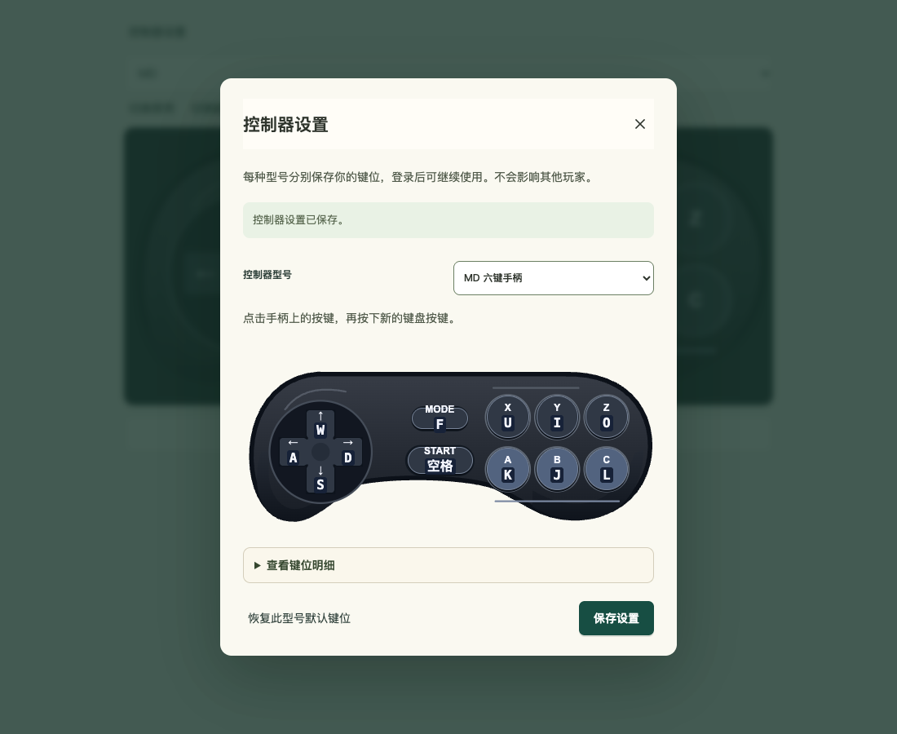
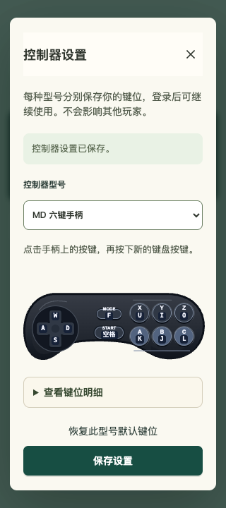

# FC／MD 控制器验收

日期：2026-10-28。型号目录提供 FC 与 MD 六键，移除 SFC。MD 的默认键位为方向 W/S/A/D、Mode F、Start 空格、B/A/C 对应 J/K/L、X/Y/Z 对应 U/I/O；FC 默认和连发保持原有行为。

| 验收范围 | 证据 |
| --- | --- |
| 实际 HTTP／SQLite、用户与型号隔离、默认键位、冲突／过期写入、重启恢复和旧 SFC 写入拒绝 | [HTTP 竞态结果](http-e2e.jsonl) |
| 共享 MD 组件与真实 React Settings；键盘、鼠标、多点触摸、隐藏释放、型号切换、重绑与恢复默认 | [MD 结果](result.json)、[原生键盘](native-keyboard.json)、[触摸](native-touch.json)、[页面隐藏](native-visibility.json) |
| 320px 命中与可读性 | [命中区](hitboxes-320.json)、[游玩对比度](contrast-play.json)、[设置对比度](contrast-settings.json) |
| FC 共享交互回归 | [FC 结果](fc-result.json)、[FC 触摸](fc-native-touch.json) |
| 原有键盘／连发逻辑、TypeScript 编译及来源摘要 | [输入回归](input-regression.txt)、[范围及摘要](verification.json) |

浏览器中的设置 API 是专用夹具；真实账号和数据库由 HTTP 验收独立覆盖。组件的游玩模式截图不是《魔强统一战》游戏接入截图，本次不包含发布。

| MD 设置：PC | MD 设置：320px |
| --- | --- |
|  |  |

MD 游玩模式见 [PC](play-desktop.png)、[320px](play-mobile-320.png)；FC 回归截图见 [PC](fc-play-desktop.png)、[320px](fc-play-mobile-320.png)。

复跑命令与边界见 [控制器文档](../../controller-settings.md) 和 [实现前测试计划](../../../scripts/controllers/md_test_plan.md)。原生键盘使用验收自有浏览器的 CDP `Input.dispatchKeyEvent`，显式指定物理 `code`；没有将合成 DOM 键盘事件作为原生结果。
